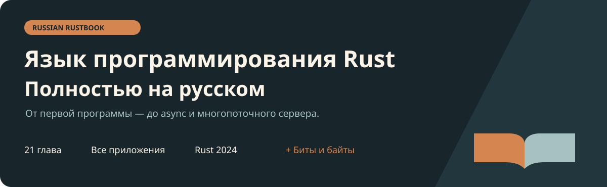

**[Читать Russian Rust Book онлайн →](https://waikizashi.github.io/russian-rustbook/)** · [Биты и байты](https://waikizashi.github.io/russian-rustbook/extras/bits-bytes/)

<p align="center"></p>

# Russian Rustbook — полная Rust Book на русском

**[The Rust Programming Language](https://doc.rust-lang.org/book/) целиком на русском: предисловие, введение, 21 глава и все приложения.**

Основное содержание следует официальной книге. Дополнительно — практический материал о битах, байтах и двоичных форматах: объяснения, упражнения, исполняемые примеры и учебный протокол.

[](https://github.com/Waikizashi/russian-rustbook/actions/workflows/ci.yml)
[](src/SUMMARY.md)
[](upstream.json)
[](NOTICE.md)

[**Начать читать →**](https://waikizashi.github.io/russian-rustbook/) · [Полное оглавление](src/SUMMARY.md) · [Сборки и выпуски](https://github.com/Waikizashi/russian-rustbook/releases) · [Биты и байты](extras/bits-bytes/README.md) · [Как помочь](CONTRIBUTING.md)

## Что внутри

| Основная книга | Практическое дополнение |
|---|---|
| Вся официальная структура: 111 исходных файлов, 542 заголовка | 12 разделов о битах, байтах и двоичных данных |
| Владение, заимствование, типажи, обобщения и времена жизни | Маски, флаги, endian, UTF-8, varint и кадрирование TCP |
| Замыкания, итераторы, умные указатели и многопоточность | 27 самостоятельных Rust-программ |
| Полная глава об async/await, futures и задачах | Упражнения с решениями |
| Unsafe Rust, макросы и финальный веб-сервер | Byte Note: кодировщик, декодировщик и тесты |

Текст читается прямо на GitHub. Сайт собирается через mdBook: с поиском, боковым оглавлением и светлой/тёмной темой. Для офлайн-чтения предусмотрена сборка EPUB и PDF без DRM.

## Версия и источники

Редакция сверена **11 ноября 2026 года** с текущими исходниками:

| Источник | Зафиксированная версия |
|---|---|
| Официальная книга [`rust-lang/book`](https://github.com/rust-lang/book) | [`2771df165f092a4fbb9f46b5b2e7450f19010adb`](https://github.com/rust-lang/book/commit/2771df165f092a4fbb9f46b5b2e7450f19010adb) |
| Русская основа [`rust-lang-ru/book`](https://github.com/rust-lang-ru/book) | [`1bec6512e7475b20919b6266dc8596ba71298ff9`](https://github.com/rust-lang-ru/book/commit/1bec6512e7475b20919b6266dc8596ba71298ff9) |
| Версия, которую предполагает книга | **Rust 1.99.1 или новее, edition 2024** |

При расхождении содержания приоритет имеет официальный английский оригинал. В русской основе актуализированы 102 файла и добавлены 7 отсутствовавших файлов главы об async. Это число файлов, включая небольшие изменения ссылок и заголовков, а не число глав, целиком переведённых заново.

Ноябрьская сверка добавила обновлённую титульную страницу и диагностику компилятора из 10 официальных файлов вывода. Rust-код в этой сверке не менялся. Машинные сведения о версиях — в [upstream.json](upstream.json), описание происхождения — в [NOTICE.md](NOTICE.md).

## Содержание основной книги

| | |
|---|---|
| [Предисловие](src/foreword.md) и [введение](src/ch00-00-introduction.md) | [12. Проект: инструмент командной строки](src/ch12-00-an-io-project.md) |
| [1. Начало работы](src/ch01-00-getting-started.md) | [13. Замыкания и итераторы](src/ch13-00-functional-features.md) |
| [2. Игра в угадывание](src/ch02-00-guessing-game-tutorial.md) | [14. Cargo и crates.io](src/ch14-00-more-about-cargo.md) |
| [3. Основные концепции](src/ch03-00-common-programming-concepts.md) | [15. Умные указатели](src/ch15-00-smart-pointers.md) |
| [4. Владение](src/ch04-00-understanding-ownership.md) | [16. Многопоточность](src/ch16-00-concurrency.md) |
| [5. Структуры](src/ch05-00-structs.md) | [17. Async, futures и задачи](src/ch17-00-async-await.md) |
| [6. Перечисления и сопоставление с образцом](src/ch06-00-enums.md) | [18. Объектно-ориентированные возможности](src/ch18-00-oop.md) |
| [7. Пакеты, крейты и модули](src/ch07-00-managing-growing-projects-with-packages-crates-and-modules.md) | [19. Образцы и сопоставление](src/ch19-00-patterns.md) |
| [8. Коллекции](src/ch08-00-common-collections.md) | [20. Продвинутые возможности](src/ch20-00-advanced-features.md) |
| [9. Обработка ошибок](src/ch09-00-error-handling.md) | [21. Проект: многопоточный веб-сервер](src/ch21-00-final-project-a-web-server.md) |
| [10. Обобщения, типажи и времена жизни](src/ch10-00-generics.md) | [Все приложения A–G](src/appendix-00.md) |
| [11. Автоматические тесты](src/ch11-00-testing.md) | [Полное оглавление с подразделами](src/SUMMARY.md) |

## Офлайн-чтение

Офлайн-файлы публикуются в [GitHub Releases](https://github.com/Waikizashi/russian-rustbook/releases) после создания проверенного тега `v*`. Пока релиза нет, EPUB и Markdown успешной сборки доступны в артефакте `russian-rustbook-offline` на вкладке [Actions](https://github.com/Waikizashi/russian-rustbook/actions/workflows/ci.yml) (для скачивания нужен вход в GitHub). PDF можно собрать локально по [BUILDING.md](BUILDING.md).

[Главы в Markdown](src/) доступны для чтения и исправлений в репозитории. Большие готовые файлы не хранятся в Git.

EPUB содержит кириллицу, иллюстрации, код, сведения об авторах, дату сборки и точный commit оригинала. Внутренние переходы работают офлайн; внешняя документация требует интернета. Для Kindle EPUB можно передать через Send to Kindle.

## Биты и байты — отдельное дополнение

[Дополнение](extras/bits-bytes/README.md) расширяет практику работы с двоичными данными и имеет собственную последовательность тем. Начать удобно после глав 3, 4 и 8 основной книги; для парсера пригодятся главы 9 и 11.

```sh
cargo test --manifest-path extras/bits-bytes/Cargo.toml --workspace --locked
cargo run --manifest-path extras/bits-bytes/Cargo.toml -p byte-note --example demo
```

Материал дополнения подготовлен специально для этого проекта. Основная книга сохраняет официальную структуру; самостоятельное дополнение явно отмечено в оглавлении.

## Собрать и проверить

Для общего сайта нужны Python 3.11.8+ и mdBook 0.5.4; для проверки исходников и EPUB — Pandoc 3.13. Для PDF дополнительно нужен PyMuPDF; для запуска примеров дополнения — стабильный Rust с Cargo.

```sh
python3 scripts/check_book.py
bash scripts/install_mdbook.sh
python3 scripts/build_site.py
python3 scripts/build_ebooks.py
python3 scripts/verify_epub.py
```

Полные команды и требования — в [BUILDING.md](BUILDING.md), результаты последней проверки — в [VALIDATION.md](VALIDATION.md). Проверки сравнивают структуру и 958 блоков кода/вывода основной книги с зафиксированной официальной версией, проверяют ссылки и собирают электронное издание.

## Как обновляется книга

Главы редактируются отдельно, а сайт, EPUB и PDF собираются из одних исходников. Для каждой главы сохранены версия английского текста и состояние проверки перевода. Изменения подключённых Rust-файлов, диагностического вывода и рисунков отслеживаются вместе с главой.

```sh
python3 scripts/upstream.py prepare --ref HEAD --output .updates/next
# Проверить отчёт, обновить затронутые русские главы и отметить их:
python3 scripts/upstream.py review --plan .updates/next ИМЯ_ГЛАВЫ.md
python3 scripts/upstream.py accept --plan .updates/next
```

Подготовка не перезаписывает русский текст. Новая версия принимается только после проверки всех затронутых глав; количество разделов не зашито в скрипты. Еженедельная проверка GitHub Actions подготавливает отчёт при изменении оригинала.

[SEO и поисковые системы](docs/SEO.md) · [Публикация и откат](docs/DEPLOYMENT.md) · [Сопровождение](docs/MAINTENANCE.md)

[Порядок обновления](docs/UPDATING.md) · [Архитектура и расширение](docs/ARCHITECTURE.md). Название, авторы и имя выпускных файлов задаются в [конфигурации публикации](config/publication.json); дополнения находятся отдельно в `extras/`.

## Участие в проекте

Вопросы, [сообщения об ошибках](https://github.com/Waikizashi/russian-rustbook/issues/new/choose) и pull requests можно писать по-русски. Книга подойдёт начинающим и разработчикам других языков; дополнение расширяет практику работы с двоичными данными. Полезны исправления терминологии, более естественные формулировки, проверка примеров и сверка новых изменений оригинала. [CONTRIBUTING.md](CONTRIBUTING.md) объясняет, где находятся исходники и как проверить изменения.

CI проверяет книгу и дополнение. Отдельный workflow отслеживает новый commit оригинала; перенос содержательных изменений требует проверки перевода. Теги версий позволяют публиковать проверенные EPUB/PDF в GitHub Releases.

## Авторы и лицензии

Авторы оригинала — **Стив Клабник, Кэрол Николс, Крис Крайко и сообщество Rust**. Русская основа — проект [rust-lang-ru/book](https://github.com/rust-lang-ru/book). Сборку и открытую редакцию сопровождает [Evgenii Panarin](https://github.com/Waikizashi); обновление перевода и подготовка дополнения выполнены с помощью ChatGPT.

Это самостоятельное неофициальное издание. Основная книга распространяется по [MIT](LICENSE-MIT) **или** [Apache-2.0](LICENSE-APACHE), как оригинал. Уведомления и лицензии русской основы сохранены в [LICENSES](LICENSES/). Код и текст дополнения — MIT; подробности и распределение авторства находятся в [NOTICE.md](NOTICE.md).
