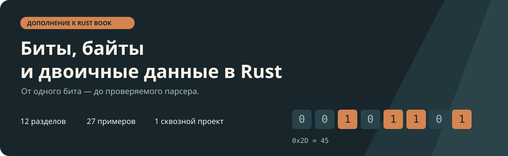

<p align="center">
  
</p>

# Биты, байты и двоичные данные в Rust

**Практическое дополнение к [The Rust Programming Language](https://doc.rust-lang.org/book/) на русском языке.**

От `0b1010` и `u8` — до разбора собственного двоичного сообщения. Последовательные объяснения, небольшие исполняемые примеры, упражнения с решениями и законченный проект без внешних Rust-зависимостей.

[](https://github.com/Waikizashi/russian-rustbook/actions/workflows/ci.yml)
[](Cargo.toml)
[](docs/00-about.md)
[](LICENSE)

[**Начать чтение →**](docs/00-about.md) · [Содержание](#содержание) · [Запустить примеры](#попробовать-код) · [Помочь проекту](CONTRIBUTING.md) · [English](README.en.md)

## Для кого

Для тех, кто уже знаком с функциями, массивами, `Option` и `Result`, но хочет увереннее работать с двоичными данными. Полезно при изучении файловых форматов, сетевых протоколов, встраиваемых систем и инструментов обработки данных.

Rust Book уже объясняет числовые типы и UTF-8. Здесь эти темы связаны с реальными байтами, дополнены побитовыми операциями и доведены до работающего кодировщика и декодировщика. Материал можно читать параллельно с основной книгой.

## Что получится

- Читать двоичную и hex-запись, понимать знак и переполнение.
- Устанавливать флаги, извлекать поля и проверять диапазоны.
- Различать число, его байтовое представление и текстовую запись.
- Работать с UTF-8, endian, буферами и срезами.
- Разбирать сообщения с проверками границ, длины и допустимых значений.
- Понимать varint, кадрирование TCP и ограничения CRC.
- Написать и проверить небольшой двоичный формат целиком.

## Содержание

| # | Тема | Практический результат |
|---:|---|---|
| — | [Как читать дополнение](docs/00-about.md) | Маршрут и связь с Rust Book |
| 1 | [Бит, байт и запись числа](docs/01-bits.md) | Перевод между decimal, binary и hex |
| 2 | [Знак, переполнение и сдвиги](docs/02-numbers.md) | Осознанный выбор `checked_*`, `wrapping_*` и преобразований |
| 3 | [Маски, флаги и поля](docs/03-masks.md) | Упаковка нескольких значений в байт |
| 4 | [Число превращается в байты](docs/04-endian.md) | Явный порядок байтов и фиксированная ширина |
| 5 | [Буферы, массивы и срезы](docs/05-buffers.md) | Чтение полей без выхода за границы |
| 6 | [ASCII, Unicode и UTF-8](docs/06-text.md) | Различение байта, `char` и видимого символа |
| 7 | [Безопасный парсер](docs/07-parser.md) | Ошибки формата вместо паники |
| 8 | [Varint и представление байтов текстом](docs/08-varint.md) | Разбор переменной длины; смысл Base64 |
| 9 | [Файлы, TCP и границы сообщений](docs/09-streams.md) | Кадры с префиксом длины |
| 10 | [Память и контрольные суммы](docs/10-memory.md) | Почему сериализация отличается от дампа структуры |
| 11 | [Проект Byte Note](docs/11-project.md) | Кодировщик, декодировщик, UTF-8 и CRC |
| 12 | [Упражнения и решения](docs/12-answers.md) | Битовый набор, цвет, массив чисел и разбор ошибок |
| — | [Шпаргалка и первичные источники](docs/13-reference.md) | Быстрый справочник |

**Первое знакомство:** 1 → 2 → 4 → 6. **Практика с форматами:** 3 → 5 → 7 → 9 → 11. Главу 8 можно пройти отдельно, когда встретится varint.

## Попробовать код

Нужны [стабильный Rust](https://www.rust-lang.org/tools/install) с Cargo и Python 3.11+. Минимальная поддерживаемая версия Rust — **1.85**, edition **2024**. У примеров и проекта нет внешних Rust-зависимостей.

```sh
git clone https://github.com/Waikizashi/russian-rustbook.git
cd russian-rustbook/extras/bits-bytes

# Проверить структуру, ссылки и соответствие кода тексту.
python3 scripts/check.py

# Скомпилировать и запустить все 27 коротких примеров.
python3 scripts/run_examples.py

# Проверить сквозной проект.
cargo test --workspace --locked
cargo run -p byte-note --example demo
```

Один пример можно запустить отдельно: `cargo run --example lesson03_02`. Соответствие примеров главам находится в [examples/README.md](examples/README.md).

`cargo test --all-targets` компилирует примеры, но не выполняет `main` каждого из них. Поэтому запуск примеров вынесен в отдельную проверку: её `assert_eq!` действительно исполняются.

## Сквозной проект: Byte Note

Небольшое сообщение состоит из сигнатуры `BYTE`, версии и типа в одном байте, флагов, длины, номера, нагрузки и CRC. Спецификация каждого поля приведена в [главе 11](docs/11-project.md#project-spec), реализация — в [crates/byte-note](crates/byte-note).

| Свойство | Как устроено |
|---|---|
| Код | Без `unsafe` и внешних зависимостей |
| Декодирование | Полезная нагрузка возвращается как заимствованный срез |
| Размер | Проверяется лимит 4096 байтов до выделения выходного буфера |
| Текст | Флаг UTF-8 означает обязательную проверку кодировки |
| Проверки | Известный вектор, усечения, повреждения, версии, флаги и границы |

Byte Note — учебный формат. Его назначение — показать проверяемую сериализацию и разбор; CRC обнаруживает случайные повреждения и не подтверждает отправителя.

## Читать как сайт и офлайн

Исходные главы читаются прямо на GitHub. Для сайта используется [mdBook](https://rust-lang.github.io/mdBook/): оглавление, поиск, темы оформления и адаптация к небольшому экрану.

```sh
cargo install mdbook --version 0.5.4 --locked
python3 scripts/prepare_book.py
mdbook serve --open
```

Для EPUB нужен [Pandoc](https://pandoc.org/). Сборка создаёт EPUB и единый Markdown с локальным оглавлением:

```sh
python3 scripts/build_ebooks.py
```

Файлы появляются в `dist/`. CI собирает их как скачиваемые артефакты; корневой workflow релиза публикует EPUB и Markdown дополнения вместе с основной книгой при теге вида `v1.0.0`. Подробности — в [документации сборки](docs/BUILDING.md).

## Как устроен репозиторий

| Каталог | Что внутри |
|---|---|
| [`docs/`](docs/) | Учебный текст, оглавление и инструкции |
| [`examples/`](examples/) | 27 самостоятельных Rust-программ |
| [`crates/byte-note/`](crates/byte-note/) | Библиотека, демонстрация и тесты формата |
| [`scripts/`](scripts/) | Проверки, подготовка сайта и экспорт |
| [`assets/`](assets/) | Обложка README и оформление |
| [`.github/`](../../.github/) | CI, публикация, формы issues и шаблон PR |

## Проверки и вклад

CI проверяет Rust на stable и MSRV, форматирование, Clippy, исполнение коротких примеров, структуру документации, внутренние ссылки, сборку сайта и EPUB. Для внешних ссылок предусмотрена отдельная проверка по расписанию, чтобы временный сбой чужого сайта не блокировал исправление текста.

Нашёл неточность, непонятное объяснение или ошибку в коде? Открой issue или pull request. Инструкция и полный набор команд — в [CONTRIBUTING.md](CONTRIBUTING.md). Начать удобно с небольшого исправления формулировки или тестового случая на границе диапазона.

## Происхождение и лицензия

Инициатор и сопровождающий — [Evgenii Panarin](https://github.com/Waikizashi). Первая редакция подготовлена с помощью ChatGPT; технические утверждения опираются на [первичные источники](docs/13-reference.md#sources), а примеры проверяются автоматически. Подробности редакционного процесса — в [PROVENANCE.md](PROVENANCE.md).

Самостоятельный проект сообщества, неофициальное дополнение к Rust Book. Текст и код распространяются по [MIT](LICENSE); можно использовать, исправлять и распространять с сохранением уведомления о лицензии. Сторонние материалы по ссылкам сохраняют свои условия использования.
