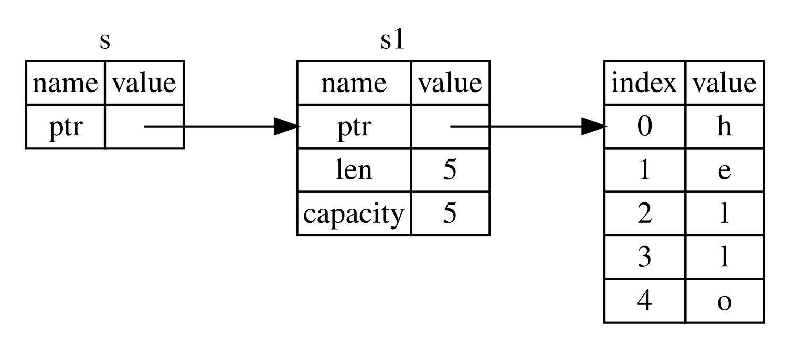

<a id="references-and-borrowing"></a>

## Ссылки и заимствование

Проблема с кодом кортежа в листинге 4-5 заключается в том, что мы должны вернуть `String` из вызванной функции, чтобы использовать `String` после вызова `calculate_length`, потому что `String` была перемещена в `calculate_length`. Вместо этого мы можем предоставить ссылку на значение `String`. *Ссылка* похожа на указатель в том смысле, что это адрес, по которому мы можем проследовать, чтобы получить доступ к данным, хранящимся по этому адресу; эти данные принадлежат какой-то другой переменной. В отличие от указателя, ссылка гарантированно указывает на допустимое значение определённого типа в течение всего срока существования этой ссылки.

Вот как вы могли бы определить и использовать функцию `calculate_length`, имеющую ссылку на объект в качестве параметра, вместо того, чтобы брать на себя ответственность за значение:

Файл: `src/main.rs`

``` rust
fn main() {
    let s1 = String::from("hello");

    let len = calculate_length(&s1);

    println!("The length of '{s1}' is {len}.");
}

fn calculate_length(s: &String) -> usize {
    s.len()
}
```

Во-первых, обратите внимание, что весь код кортежа в объявлении переменной и возвращаемое значение функции исчезли. Во-вторых, обратите внимание, что мы передаём `&s1` в `calculate_length` и в его определении используем `&String`, а не `String`. Эти амперсанды представляют собой *ссылки*, и они позволяют вам ссылаться на некоторое значение, не принимая владение над ним. Рисунок 4-6 изображает эту концепцию.



Рисунок 4-6: Ссылка `s` типа `&String` указывает на `s1` типа `String`

> Примечание: противоположностью ссылки с использованием `&` является *разыменование*, выполняемое с помощью оператора разыменования `*`. Мы увидим некоторые варианты использования оператора разыменования в главе 8 и обсудим детали разыменования в главе 15.

Давайте подробнее рассмотрим механизм вызова функции:

``` rust
    let s1 = String::from("hello");

    let len = calculate_length(&s1);
```

`&s1` позволяет нам создать ссылку, которая *ссылается* на значение `s1`, но не владеет им. Поскольку она не владеет им, значение, на которое она указывает, не будет удалено, когда ссылка перестанет использоваться.

Сигнатура функции использует `&` для индикации того, что тип параметра `s` является ссылкой. Добавим объясняющие комментарии:

``` rust
fn calculate_length(s: &String) -> usize { // s is a reference to a String
    s.len()
} // Here, s goes out of scope. But because s does not have ownership of what
  // it refers to, the String is not dropped.
```

Область действия `s` такая же, как и область действия любого параметра функции, но значение, на которое указывает ссылка, не удаляется, когда `s` перестаёт использоваться, потому что `s` не является его владельцем. Когда функции имеют ссылки в качестве параметров вместо фактических значений, нам не нужно возвращать значения, чтобы вернуть право владения, потому что мы никогда не владели ими.

Мы называем процесс создания ссылки *заимствованием*. Как и в реальной жизни, если человек чем-то владеет, вы можете это у него позаимствовать. Когда вы закончите, вы должны вернуть это законному владельцу.

А что произойдёт, если попытаться изменить то, что было позаимствовано? Попробуйте код листинга 4-6 Спойлер: этот код не сработает!

Файл: `src/main.rs`

``` rust
fn main() {
    let s = String::from("hello");

    change(&s);
}

fn change(some_string: &String) {
    some_string.push_str(", world");
}
```

Листинг 4-6: попытка модификации заимствованной переменной

Здесь ошибка:

``` console
$ cargo run
   Compiling ownership v0.1.0 (file:///projects/ownership)
error[E0596]: cannot borrow `*some_string` as mutable, as it is behind a `&` reference
 --> src/main.rs:8:5
  |
8 |     some_string.push_str(", world");
  |     ^^^^^^^^^^^ `some_string` is a `&` reference, so it cannot be borrowed as mutable
  |
help: consider changing this to be a mutable reference
  |
7 | fn change(some_string: &mut String) {
  |                         +++

For more information about this error, try `rustc --explain E0596`.
error: could not compile `ownership` (bin "ownership") due to 1 previous error
```

Как переменные неизменяемы по умолчанию, так и ссылки. Нам не разрешено изменять то, на что у нас есть ссылка.

<a id="mutable-references"></a>

### Изменяемые ссылки

Мы можем исправить код из листинга 4-6, чтобы позволить себе изменять заимствованное значение, с помощью нескольких небольших настроек, которые используют *изменяемую ссылку*:

Файл: `src/main.rs`

``` rust
fn main() {
    let mut s = String::from("hello");

    change(&mut s);
}

fn change(some_string: &mut String) {
    some_string.push_str(", world");
}
```

Сначала мы меняем `s` на `mut`. Затем мы создаём изменяемую ссылку с помощью `&mut s`, у которой вызываем `change` и обновляем сигнатуру функции, чтобы принять изменяемую ссылку с помощью `some_string: &mut String`. Это даёт понять, что `change` изменит значение, которое заимствует.

Изменяемые ссылки имеют одно большое ограничение: если у вас есть изменяемая ссылка на значение, у вас не может быть других ссылок на это же значение. Код, который пытается создать две изменяемые ссылки на `s`, завершится ошибкой:

Файл: `src/main.rs`

``` rust
    let mut s = String::from("hello");

    let r1 = &mut s;
    let r2 = &mut s;

    println!("{r1}, {r2}");
```

Здесь ошибка:

``` console
$ cargo run
   Compiling ownership v0.1.0 (file:///projects/ownership)
error[E0499]: cannot borrow `s` as mutable more than once at a time
 --> src/main.rs:5:14
  |
4 |     let r1 = &mut s;
  |              ------ first mutable borrow occurs here
5 |     let r2 = &mut s;
  |              ^^^^^^ second mutable borrow occurs here
6 |
7 |     println!("{r1}, {r2}");
  |                -- first borrow later used here

For more information about this error, try `rustc --explain E0499`.
error: could not compile `ownership` (bin "ownership") due to 1 previous error
```

Эта ошибка говорит о том, что код недействителен, потому что мы не можем заимствовать `s` как изменяемые более одного раза в один момент. Первое изменяемое заимствование находится в `r1` и должно длиться до тех пор, пока оно не будет использовано в `println!`, но между созданием этой изменяемой ссылки и её использованием мы попытались создать другую изменяемую ссылку в `r2`, которая заимствует те же данные, что и `r1`.

Ограничение, предотвращающее одновременное использование нескольких изменяемых ссылок на одни и те же данные, допускает изменение, но очень контролируемым образом. Это то, с чем борются новые Rustaceans, потому что большинство языков позволяют изменять значение в любой момент. Преимущество этого ограничения заключается в том, что Rust может предотвратить гонку данных во время компиляции. *Гонка данных* похожа на состояние гонки и происходит, когда возникают следующие три сценария:

- Два или больше указателей используют одни и те же данные в одно и то же время,
- Минимум один указатель используется для записи данных,
- Отсутствуют механизмы для синхронизации доступа к данным.

Гонки данных вызывают неопределённое поведение, и их может быть сложно диагностировать и исправить, когда вы пытаетесь отследить их во время выполнения. Rust предотвращает такую проблему, отказываясь компилировать код с гонками данных!

Как всегда, мы можем использовать фигурные скобки для создания новой области видимости, позволяющей использовать несколько изменяемых ссылок, но не *одновременно*:

``` rust
    let mut s = String::from("hello");

    {
        let r1 = &mut s;
    } // r1 goes out of scope here, so we can make a new reference with no problems.

    let r2 = &mut s;
```

Rust применяет аналогичное правило для комбинирования изменяемых и неизменяемых ссылок. Этот код приводит к ошибке:

``` rust
    let mut s = String::from("hello");

    let r1 = &s; // no problem
    let r2 = &s; // no problem
    let r3 = &mut s; // BIG PROBLEM

    println!("{r1}, {r2}, and {r3}");
```

Здесь ошибка:

``` console
$ cargo run
   Compiling ownership v0.1.0 (file:///projects/ownership)
error[E0502]: cannot borrow `s` as mutable because it is also borrowed as immutable
 --> src/main.rs:6:14
  |
4 |     let r1 = &s; // no problem
  |              -- immutable borrow occurs here
5 |     let r2 = &s; // no problem
6 |     let r3 = &mut s; // BIG PROBLEM
  |              ^^^^^^ mutable borrow occurs here
7 |
8 |     println!("{r1}, {r2}, and {r3}");
  |                -- immutable borrow later used here

For more information about this error, try `rustc --explain E0502`.
error: could not compile `ownership` (bin "ownership") due to 1 previous error
```

Вау! У нас *также* не может быть изменяемой ссылки, пока у нас есть неизменяемая ссылка на то же значение.

Пользователи неизменяемой ссылки не ожидают, что значение внезапно изменится из-под них! Однако разрешены множественные неизменяемые ссылки, потому что никто, кто просто читает данные, не может повлиять на чтение данных кем-либо ещё.

Обратите внимание, что область действия ссылки начинается с того места, где она была введена, и продолжается до последнего использования этой ссылки. Например, этот код будет компилироваться, потому что последнее использование неизменяемых ссылок `println!`, происходит до того, как вводится изменяемая ссылка:

``` rust
    let mut s = String::from("hello");

    let r1 = &s; // no problem
    let r2 = &s; // no problem
    println!("{r1} and {r2}");
    // Variables r1 and r2 will not be used after this point.

    let r3 = &mut s; // no problem
    println!("{r3}");
```

Области неизменяемых ссылок `r1` и `r2` заканчиваются после `println!` где они использовались в последний раз, то есть до создания изменяемой ссылки `r3`. Эти области не перекрываются, поэтому этот код разрешён: компилятор может сказать, что ссылка больше не используется в точке перед концом области.

Несмотря на то, что ошибки заимствования могут иногда вызывать разочарование, помните, что компилятор Rust заранее указывает на потенциальную ошибку (во время компиляции, а не во время выполнения) и точно показывает, в чем проблема. Тогда вам не придётся выяснять, почему ваши данные оказались не такими, как вы ожидали.

<a id="dangling-references"></a>

### Висячие ссылки

В языках с указателями весьма легко ошибочно создать недействительную (висячую) *(dangling)* ссылку. Ссылку указывающую на участок памяти, который мог быть передан кому-то другому, путём освобождения некоторой памяти при сохранении указателя на эту память. Rust компилятор гарантирует, что ссылки никогда не станут недействительными: если у вас есть ссылка на какие-то данные, компилятор обеспечит что эти данные не выйдут из области видимости прежде, чем из области видимости исчезнет ссылка.

Давайте попробуем создать висячую ссылку, чтобы увидеть, как Rust предотвращает их появление с помощью ошибки во время компиляции:

Файл: `src/main.rs`

``` rust
fn main() {
    let reference_to_nothing = dangle();
}

fn dangle() -> &String {
    let s = String::from("hello");

    &s
}
```

Здесь ошибка:

``` console
$ cargo run
   Compiling ownership v0.1.0 (file:///projects/ownership)
error[E0106]: missing lifetime specifier
 --> src/main.rs:5:16
  |
5 | fn dangle() -> &String {
  |                ^ expected named lifetime parameter
  |
  = help: this function's return type contains a borrowed value, but there is no value for it to be borrowed from
help: consider using the `'static` lifetime, but this is uncommon unless you're returning a borrowed value from a `const` or a `static`
  |
5 | fn dangle() -> &'static String {
  |                 +++++++
help: instead, you are more likely to want to return an owned value
  |
5 - fn dangle() -> &String {
5 + fn dangle() -> String {
  |

For more information about this error, try `rustc --explain E0106`.
error: could not compile `ownership` (bin "ownership") due to 1 previous error
```

Это сообщение об ошибке относится к особенности языка, которую мы ещё не рассмотрели: времени жизни. Мы подробно обсудим времена жизни в главе 10. Но если вы не обращаете внимания на части, касающиеся времени жизни, сообщение будет содержать ключ к тому, почему этот код является проблемой:

``` text
this function's return type contains a borrowed value, but there is no value
for it to be borrowed from
```

Давайте подробнее рассмотрим, что именно происходит на каждом этапе нашего кода `dangle`:

Файл: `src/main.rs`

``` rust
fn dangle() -> &String { // dangle returns a reference to a String

    let s = String::from("hello"); // s is a new String

    &s // we return a reference to the String, s
} // Here, s goes out of scope and is dropped, so its memory goes away.
  // Danger!
```

Поскольку `s` создаётся внутри `dangle`, когда код `dangle` будет завершён, `s` будет освобождена. Но мы попытались вернуть ссылку на неё. Это означает, что эта ссылка будет указывать на недопустимую `String`. Это нехорошо! Rust не позволит нам сделать это.

Решением будет вернуть непосредственно `String`:

``` rust
fn no_dangle() -> String {
    let s = String::from("hello");

    s
}
```

Это работает без проблем. Владение перемещено, и ничего не освобождено.

<a id="the-rules-of-references"></a>

### Правила работы с ссылками

Давайте повторим все, что мы обсудили про ссылки:

- В любой момент времени у вас может быть *одна* (но не обе) изменяемая ссылка или любое количество неизменяемых ссылок.
- Все ссылки должны быть действительными.

В следующей главе мы рассмотрим другой тип ссылок — срезы.
