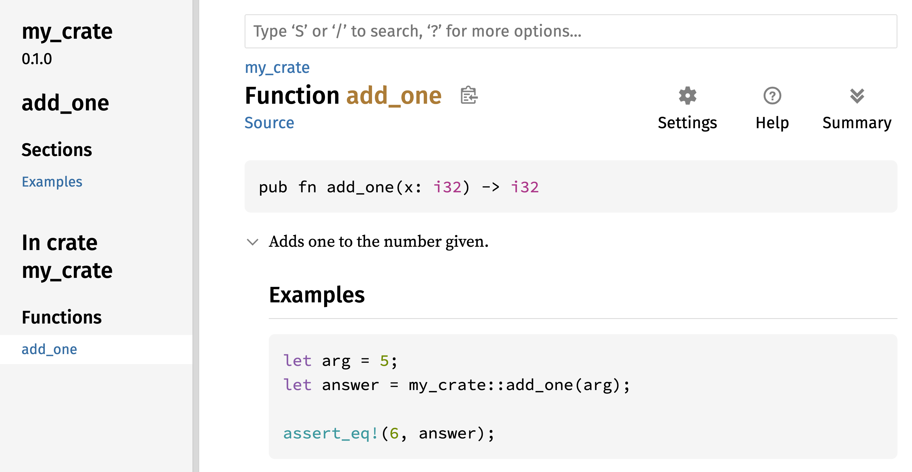
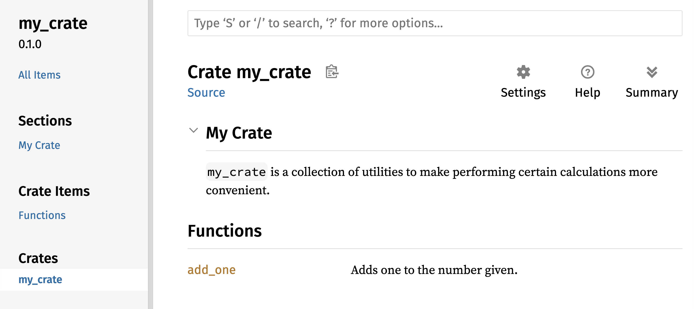
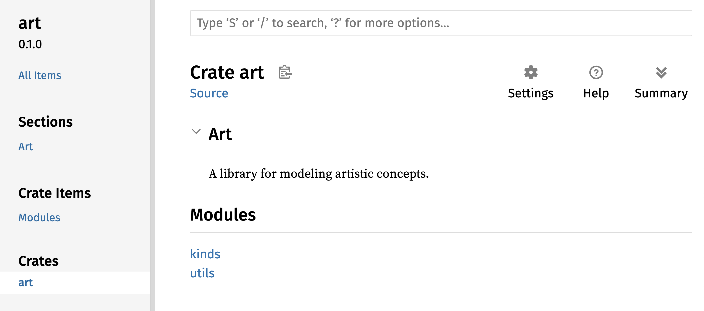
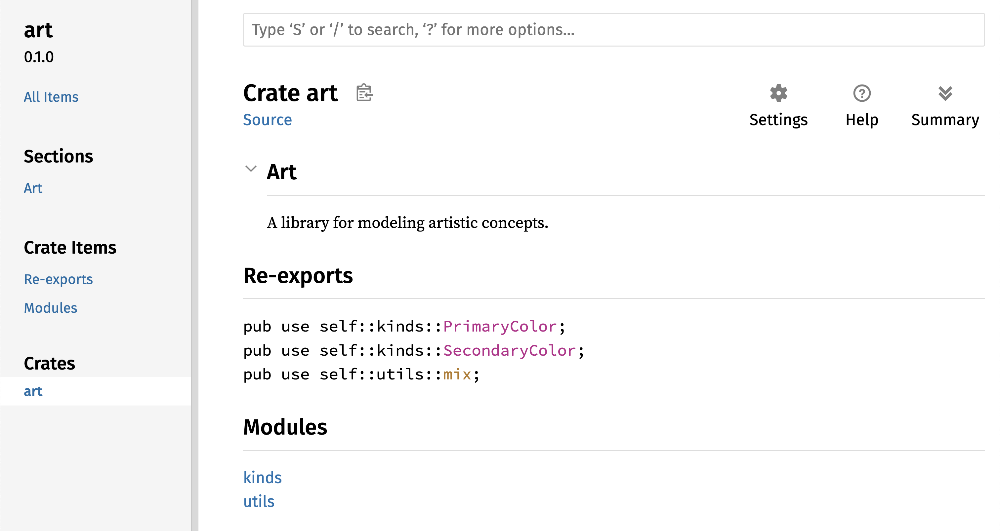

<a id="publishing-a-crate-to-crates.io"></a>

## Публикация библиотеки в Crates.io

Мы использовали пакеты из [crates.io](https://crates.io/) в качестве зависимостей нашего проекта, но вы также можете поделиться своим кодом с другими людьми, опубликовав свои собственные пакеты. Реестр библиотек по адресу [crates.io](https://crates.io/) распространяет исходный код ваших пакетов, поэтому он в основном размещает код с открытым исходным кодом.

В Rust и Cargo есть функции, которые облегчают поиск и использование опубликованного пакета. Далее мы поговорим о некоторых из этих функций, а затем объясним, как опубликовать пакет.

<a id="making-useful-documentation-comments"></a>

### Создание полезных комментариев к документации

Аккуратное документирование ваших пакетов поможет другим пользователям знать, как и когда их использовать, поэтому стоит потратить время на написание документации. В главе 3 мы обсуждали, как комментировать код Rust, используя две косые черты, `//`. В Rust также есть особый вид комментариев к документации, который обычно называется *комментарием к документации*, который генерирует документацию HTML. HTML-код отображает содержимое комментариев к документации для публичных элементов API, предназначенных для программистов, заинтересованных в знании того, как *использовать* вашу библиотеку, в отличие от того, как она *реализована*.

Комментарии к документации используют три слеша, `///` вместо двух и поддерживают нотацию Markdown для форматирования текста. Размещайте комментарии к документации непосредственно перед элементом, который они документируют. В листинге 14-1 показаны комментарии к документации для функции `add_one` в библиотеке с именем `my_crate`:

Файл: `src/lib.rs`

``` rust
/// Adds one to the number given.
///
/// # Examples
///
/// ```
/// let arg = 5;
/// let answer = my_crate::add_one(arg);
///
/// assert_eq!(6, answer);
/// ```
pub fn add_one(x: i32) -> i32 {
    x + 1
}
```

Листинг 14-1: Комментарий к документации для функции

Здесь мы даём описание того, что делает функция `add_one`, начинаем раздел с заголовка `Examples`, а затем предоставляем код, который демонстрирует, как использовать функцию `add_one`. Мы можем сгенерировать документацию HTML из этого комментария к документации, запустив `cargo doc`. Эта команда запускает инструмент `rustdoc`, поставляемый с Rust, и помещает сгенерированную HTML-документацию в каталог *target/doc*.

Для удобства, запустив `cargo doc --open`, мы создадим HTML для документации вашей текущей библиотеки (а также документацию для всех зависимостей вашей библиотеки) и откроем результат в веб-браузере. Перейдите к функции `add_one` и вы увидите, как отображается текст в комментариях к документации, что показано на рисунке 14-1:



Рисунок 14-1: HTML документация для функции `add_one`

<a id="commonly-used-sections"></a>

#### Часто используемые разделы

Мы использовали Markdown заголовок `# Examples` в листинге 14-1 для создания раздела в HTML с заголовком “Examples”. Вот некоторые другие разделы, которые авторы библиотек обычно используют в своей документации:

- **Panics**: Сценарии, в которых документированная функция может вызывать панику. Вызывающие функцию, которые не хотят, чтобы их программы паниковали, должны убедиться, что они не вызывают функцию в этих ситуациях.
- **Ошибки**: Если функция возвращает `Result`, описание типов ошибок, которые могут произойти и какие условия могут привести к тому, что эти ошибки могут быть возвращены, может быть полезным для вызывающих, так что они могут написать код для обработки различных типов ошибок разными способами.
- **Безопасность**: Если функция является `unsafe` для вызова (мы обсуждаем безопасность в главе 20), должен быть раздел, объясняющий, почему функция небезопасна и охватывающий инварианты, которые функция ожидает от вызывающих сторон.

В подавляющем большинстве случаев комментарии к документации не нуждаются во всех этих разделах, но это хорошая подсказка, напоминающая вам о тех аспектах вашего кода, о которых пользователям будет интересно узнать.

<a id="documentation-comments-as-tests"></a>

#### Комментарии к документации как тесты

Добавление примеров кода в комментарии к документации может помочь продемонстрировать, как использовать вашу библиотеку, и это даёт дополнительный бонус: запуск `cargo test` запустит примеры кода в вашей документации как тесты! Нет ничего лучше, чем документация с примерами. Но нет ничего хуже, чем примеры, которые не работают, потому что код изменился с момента написания документации. Если мы запустим `cargo test` с документацией для функции `add_one` из листинга 14-1, мы увидим раздел результатов теста, подобный этому:

``` text
   Doc-tests my_crate

running 1 test
test src/lib.rs - add_one (line 5) ... ok

test result: ok. 1 passed; 0 failed; 0 ignored; 0 measured; 0 filtered out; finished in 0.27s
```

Теперь, если мы изменим либо функцию, либо пример, так что `assert_eq!` в примере паникует, и снова запустим `cargo test`, мы увидим, что тесты документации обнаруживают, что пример и код не синхронизированы друг с другом!

<span id="commenting-contained-items"></span>

<a id="contained-item-comments"></a>

#### Комментарии для содержащего элемента

Стиль комментариев к документам `//!` добавляет документацию к элементу, содержащему комментарии, а не к элементам, следующим за комментариями. Обычно мы используем эти комментарии внутри корневого файла крейта (по соглашению *src/lib.rs* ) или внутри модуля для документирования крейта или модуля в целом.

Например, чтобы добавить документацию, описывающую назначение `my_crate` , содержащего функцию `add_one` , мы добавляем комментарии к документации, начинающиеся с `//!` в начало файла *src/lib.rs* , как показано в листинге 14-2:

Файл: `src/lib.rs`

``` rust
//! # My Crate
//!
//! `my_crate` is a collection of utilities to make performing certain
//! calculations more convenient.

/// Adds one to the number given.
// --snip--
```

Листинг 14-2: Документация для крейта `my_crate` в целом

Обратите внимание, что после последней строки, начинающейся с `//!`, нет никакого кода. Поскольку мы начали комментарии с `//!` вместо `///`, мы документируем элемент, который содержит этот комментарий, а не элемент, который следует за этим комментарием. В данном случае таким элементом является файл *src/lib.rs*, который является корнем crate. Эти комментарии описывают весь крейт.

Когда мы запускаем `cargo doc --open`, эти комментарии будут отображаться на первой странице документации для `my_crate` над списком публичных элементов в библиотеке, как показано на рисунке 14-2:

Комментарии к документации внутри элементов полезны для описания крейтов и модулей особенно. Используйте их, чтобы объяснить общую цель контейнера, чтобы помочь вашим пользователям понять организацию крейта.



Рисунок 14-2: Предоставленная документация для `my_crate`, включая комментарий, описывающие крейт в целом

<span id="exporting-a-convenient-public-api-with-pub-use"></span>

<a id="exporting-a-convenient-public-api"></a>

### Экспорт удобного открытого API

Структура вашего публичного API является основным фактором при публикации крейта. Люди, которые используют вашу библиотеку, менее знакомы со структурой, чем вы и могут столкнуться с трудностями при поиске частей, которые они хотят использовать, если ваша библиотека имеет большую иерархию модулей.

В главе 7 мы рассмотрели, как сделать элементы общедоступными с помощью ключевого слова `pub` и ввести элементы в область видимости с помощью ключевого слова `use`. Однако структура, которая имеет смысл для вас при разработке крейта, может быть не очень удобной для пользователей. Вы можете организовать структуру в виде иерархии с несколькими уровнями, но тогда люди, желающие использовать тип, который вы определили в глубине иерархии, могут столкнуться с проблемой его поиска. Их также может раздражать необходимость вводить `use` `my_crate::some_module::another_module::UsefulType;` вместо `use` `my_crate::UsefulType;`.

Хорошей новостью является то, что если структура *не* удобна для использования другими из другой библиотеки, вам не нужно перестраивать внутреннюю организацию: вместо этого вы можете реэкспортировать элементы, чтобы сделать публичную структуру, отличную от вашей внутренней структуры, используя `pub use`. Реэкспорт берет открытый элемент в одном месте и делает его публичным в другом месте, как если бы он был определён в другом месте.

Например, скажем, мы создали библиотеку с именем `art` для моделирования художественных концепций. Внутри этой библиотеки есть два модуля: модуль `kinds` содержащий два перечисления с именами `PrimaryColor` и `SecondaryColor` и модуль `utils`, содержащий функцию с именем `mix`, как показано в листинге 14-3:

Файл: `src/lib.rs`

``` rust
//! # Art
//!
//! A library for modeling artistic concepts.

pub mod kinds {
    /// The primary colors according to the RYB color model.
    pub enum PrimaryColor {
        Red,
        Yellow,
        Blue,
    }

    /// The secondary colors according to the RYB color model.
    pub enum SecondaryColor {
        Orange,
        Green,
        Purple,
    }
}

pub mod utils {
    use crate::kinds::*;

    /// Combines two primary colors in equal amounts to create
    /// a secondary color.
    pub fn mix(c1: PrimaryColor, c2: PrimaryColor) -> SecondaryColor {
        // --snip--
    }
}
```

Листинг 14-3: Библиотека `art` с элементами, организованными в модули `kinds` и `utils`

На рисунке 14-3 показано, как будет выглядеть титульная страница документации для этого крейта, сгенерированный `cargo doc`:



Рисунок 14-3: Первая страница документации для `art`, в которой перечислены модули `kinds` и `utils`

Обратите внимание, что типы `PrimaryColor` и `SecondaryColor` не указаны на главной странице, равно как и функция `mix`. Мы должны нажать `kinds` и `utils`, чтобы увидеть их.

В другой библиотеке, которая зависит от этой библиотеки, потребуются операторы `use`, которые подключают элементы из `art` в область видимости, определяя структуру модуля, которая определена в данный момент. В листинге 14-4 показан пример крейта, в котором используются элементы `PrimaryColor` и `mix` из крейта `art`:

Файл: `src/main.rs`

``` rust
use art::kinds::PrimaryColor;
use art::utils::mix;

fn main() {
    let red = PrimaryColor::Red;
    let yellow = PrimaryColor::Yellow;
    mix(red, yellow);
}
```

Листинг 14-4: Крейт использующий элементы из крейта `art` с экспортированной внутренней структурой

Автору кода в листинге 14-4, который использует крейт `art`, пришлось выяснить, что `PrimaryColor` находится в модуле `kinds`, а `mix` - в модуле `utils`. Структура модуля `art` крейта больше подходит для разработчиков, работающих над `art` крейтом, чем для тех, кто его использует. Внутренняя структура не содержит никакой полезной информации для того, кто пытается понять, как использовать крейт `art`, а скорее вызывает путаницу, поскольку разработчики, использующие его, должны понять, где искать, и должны указывать имена модулей в выражениях `use`.

Чтобы удалить внутреннюю организацию из общедоступного API, мы можем изменить код крейта `art` в листинге 14-3, чтобы добавить операторы `pub use` для повторного реэкспорта элементов на верхнем уровне, как показано в листинге 14-5:

Файл: `src/lib.rs`

``` rust
//! # Art
//!
//! A library for modeling artistic concepts.

pub use self::kinds::PrimaryColor;
pub use self::kinds::SecondaryColor;
pub use self::utils::mix;

pub mod kinds {
    // --snip--
}

pub mod utils {
    // --snip--
}
```

Листинг 14-5: Добавление операторов `pub use` для реэкспорта элементов

Документация API, которую `cargo doc` генерирует для этой библиотеки, теперь будет перечислять и связывать реэкспорты на главной странице, как показано на рисунке 14-4, упрощая поиск типов `PrimaryColor`, `SecondaryColor` и функции `mix`.



Рисунок 14-4: Первая страница документации для `art`, которая перечисляет реэкспорт

Пользователи крейта `art` могут по-прежнему видеть и использовать внутреннюю структуру из листинга 14-3, как показано в листинге 14-4, или они могут использовать более удобную структуру в листинге 14-5, как показано в листинге 14-6:

Файл: `src/main.rs`

``` rust
use art::PrimaryColor;
use art::mix;

fn main() {
    // --snip--
}
```

Листинг 14-6: Программа, использующая реэкспортированные элементы из крейта `art`

В случаях, когда имеется много вложенных модулей, реэкспорт типов на верхнем уровне с помощью `pub use` может существенно повысить удобство работы для людей, использующих крейт. Ещё одно распространённое использование `pub use` - это реэкспорт определений зависимого модуля в текущем крейте, чтобы сделать определения этого крейта частью публичного API вашего крейта.

Создание полезной публичной структуры API - это больше искусство чем наука, и вы можете повторять, чтобы найти API, который лучше всего подойдёт вашим пользователям. Использование `pub use` даёт вам гибкость в том, как вы структурируете свою библиотеку внутри и отделяете эту внутреннюю структуру от того, что вы предоставляете пользователям. Посмотрите на код некоторых установленных крейтов, чтобы увидеть отличается ли их внутренняя структура от их публичного API.

<a id="setting-up-a-crates.io-account"></a>

### Настройка учётной записи Crates.io

Перед публикацией крейтов нужно создать учётную запись на [crates.io](https://crates.io/) и получить токен API. Откройте [главную страницу](https://crates.io/) и войдите через GitHub. Сейчас учётная запись GitHub обязательна, но в будущем могут появиться другие способы регистрации. Затем перейдите в [настройки учётной записи](https://crates.io/me/) и получите ключ API. Выполните `cargo login` и вставьте ключ по запросу:

``` console
$ cargo login
abcdefghijklmnopqrstuvwxyz012345
```

Команда сообщает Cargo ваш токен API и сохраняет его локально в *~/.cargo/credentials.toml*. Токен секретный: никому его не передавайте. Если он по какой-либо причине стал известен другому человеку, отзовите его и создайте новый на [crates.io](https://crates.io/).

<a id="adding-metadata-to-a-new-crate"></a>

### Добавление метаданных в новую библиотеку

Допустим, у вас есть крейт, который вы хотите опубликовать. Перед публикацией вам нужно добавить некоторые метаданные в раздел `[package]` файла *Cargo.toml* крейта.

Вашему крейту понадобится уникальное имя. Пока вы работаете над крейтом локально, вы можете назвать его как угодно. Однако названия крейтов на [crates.io](https://crates.io/) фиксируются в момент первой публикации. Как только крейту присвоено название, никто другой не сможет опубликовать крейт с таким же именем. Перед тем как опубликовать крейт, поищите название, которое вы хотите использовать. Если такое имя уже используется, вам придётся подобрать другое и отредактировать поле `name` в файле *Cargo.toml* в разделе `[package]`, чтобы использовать новое имя в качестве публикуемого, например, так:

Файл: Cargo.toml

``` toml
[package]
name = "guessing_game"
```

Даже если вы выбрали уникальное имя, когда вы запустите `cargo publish` чтобы опубликовать крейт, вы получите предупреждение, а затем ошибку:

``` console
$ cargo publish
    Updating crates.io index
warning: manifest has no description, license, license-file, documentation, homepage or repository.
See https://doc.rust-lang.org/cargo/reference/manifest.html#package-metadata for more info.
--snip--
error: failed to publish to registry at https://crates.io

Caused by:
  the remote server responded with an error (status 400 Bad Request): missing or empty metadata fields: description, license. Please see https://doc.rust-lang.org/cargo/reference/manifest.html for more information on configuring these fields
```

Это ошибка, потому что вам не хватает важной информации: необходимы описание и лицензия, чтобы люди знали, что делает ваш крейт и на каких условиях они могут его использовать. В поле *Cargo.toml* добавьте описание, состоящее из одного-двух предложений, поскольку оно будет появляться вместе с вашим крейтом в результатах поиска. Для поля `license` нужно указать значение *идентификатора лицензии*. В [Linux Foundation’s Software Package Data Exchange (SPDX)](https://spdx.org/licenses/) перечислены идентификаторы, которые можно использовать для этого значения. Например, чтобы указать, что вы лицензировали свой crate, используя лицензию MIT, добавьте идентификатор `MIT`:

Файл: Cargo.toml

``` toml
[package]
name = "guessing_game"
license = "MIT"
```

Если вы хотите использовать лицензию, которая отсутствует в SPDX, вам нужно поместить текст этой лицензии в файл, включите файл в свой проект, а затем используйте `license-file`, чтобы указать имя этого файла вместо использования ключа `license`.

Руководство по выбору лицензии для вашего проекта выходит за рамки этой книги. Многие люди в сообществе Rust лицензируют свои проекты так же, как и Rust, используя двойную лицензию `MIT OR Apache-2.0`. Эта практика демонстрирует, что вы также можете указать несколько идентификаторов лицензий, разделённых `OR`, чтобы иметь несколько лицензий для вашего проекта.

С добавлением уникального имени, версии, вашего описания и лицензии, файл *Cargo.toml* для проекта, который готов к публикации может выглядеть следующим образом:

Файл: Cargo.toml

``` toml
[package]
name = "guessing_game"
version = "0.1.0"
edition = "2024"
description = "A fun game where you guess what number the computer has chosen."
license = "MIT OR Apache-2.0"

[dependencies]
```

[Документация Cargo](https://doc.rust-lang.org/cargo/) описывает другие метаданные, которые вы можете указать, чтобы другие могли легче находить и использовать ваш крейт.

<a id="publishing-to-crates.io"></a>

### Публикация на Crates.io

Теперь, когда вы создали учётную запись, сохранили свой токен API, выбрали имя для своего крейта и указали необходимые метаданные, вы готовы к публикации! Публикация библиотеки загружает определённую версию в [crates.io](https://crates.io/) для использования другими.

Будьте внимательны: публикация постоянна. Версию нельзя перезаписать, а удалить код можно лишь при определённых обстоятельствах. Одна из главных целей Crates.io — постоянный архив кода, обеспечивающий сборку всех проектов, зависящих от крейтов на [crates.io](https://crates.io/). Свободное удаление версий сделало бы это невозможным. Зато число публикуемых версий крейта не ограничено.

Запустите команду `cargo publish` ещё раз. Сейчас эта команда должна выполниться успешно:

``` console
$ cargo publish
    Updating crates.io index
   Packaging guessing_game v0.1.0 (file:///projects/guessing_game)
    Packaged 6 files, 1.2KiB (895.0B compressed)
   Verifying guessing_game v0.1.0 (file:///projects/guessing_game)
   Compiling guessing_game v0.1.0
(file:///projects/guessing_game/target/package/guessing_game-0.1.0)
    Finished `dev` profile [unoptimized + debuginfo] target(s) in 0.19s
   Uploading guessing_game v0.1.0 (file:///projects/guessing_game)
    Uploaded guessing_game v0.1.0 to registry `crates-io`
note: waiting for `guessing_game v0.1.0` to be available at registry
`crates-io`.
You may press ctrl-c to skip waiting; the crate should be available shortly.
   Published guessing_game v0.1.0 at registry `crates-io`
```

Поздравляем! Теперь вы поделились своим кодом с сообществом Rust и любой может легко добавить вашу библиотеку в качестве зависимости их проекта.

<a id="publishing-a-new-version-of-an-existing-crate"></a>

### Публикация новой версии существующей библиотеки

Когда вы внесли изменения в свой крейт и готовы выпустить новую версию, измените значение `version`, указанное в вашем файле *Cargo.toml* и повторите публикацию. Воспользуйтесь [Semantic Versioning rules](https://semver.org/), чтобы решить, какой номер следующей версии подходит для ваших изменений. Затем запустите `cargo publish`, чтобы загрузить новую версию.

<span id="removing-versions-from-cratesio-with-cargo-yank"></span> <span id="deprecating-versions-from-cratesio-with-cargo-yank"></span>

<a id="deprecating-versions-from-crates.io"></a>

### Отзыв версий на Crates.io

Хотя вы не можете удалить предыдущие версии крейта, вы можете помешать любым будущим проектам добавлять его в качестве новой зависимости. Это полезно, когда версия крейта сломана по той или иной причине. В таких ситуациях Cargo поддерживает *выламывание* (yanking) версии крейта.

Вычёркивание версии не позволяет новым проектам зависеть от этой версии, но при этом позволяет всем существующим проектам, зависящим от неё, продолжать работу. По сути, исключение означает, что все проекты с *Cargo.lock* не сломаются, а любые файлы *Cargo.lock*, которые будут генерироваться в будущем, не смогут использовать исключённую версию.

Чтобы вычеркнуть версию крейта, в директории крейта, который вы опубликовали ранее, выполните команду `cargo yank` и укажите, какую версию вы хотите вычеркнуть. Например, если мы опубликовали крейт под названием `guessing_game` версии 1.0.1 и хотим вычеркнуть её, в каталоге проекта для `guessing_game` мы выполним:

``` console
$ cargo yank --vers 1.0.1
    Updating crates.io index
        Yank guessing_game@1.0.1
```

Добавив в команду `--undo`, вы также можете отменить выламывание и разрешить проектам начать зависеть от версии снова:

``` console
$ cargo yank --vers 1.0.1 --undo
    Updating crates.io index
      Unyank guessing_game@1.0.1
```

Вычёркивание *не удаляет* код. Оно не может, например, удалить случайно загруженные пароли. Если это произойдёт, вы должны немедленно сбросить эти пароли.
