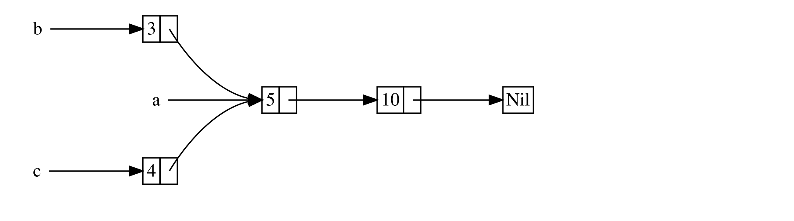

<a id="rct-the-reference-counted-smart-pointer"></a>

## `Rc<T>` — умный указатель с подсчётом ссылок

В большинстве ситуаций владение является однозначным: вы точно знаете, какая переменная владеет данным значением. Однако бывают случаи, когда у одного значения может быть несколько владельцев. Например, в Графовых структурах может быть несколько рёбер, указывающих на один и тот же узел — таким образом, этот узел становится фактически собственностью всех этих рёбер. Узел не подлежит удалению, за исключением тех случаев, когда на него не указывает ни одно ребро и, соответственно, у него нет владельцев.

Вы должны включить множественное владение явно, используя тип Rust `Rc<T>`, который является аббревиатурой для *подсчёта ссылок*. Тип `Rc<T>` отслеживает количество ссылок на значение, чтобы определить, используется ли оно ещё. Если ссылок на значение нет, значение может быть очищено и при этом ни одна ссылка не станет недействительной.

Представьте себе `Rc<T>` как телевизор в гостиной. Когда один человек входит, чтобы смотреть телевизор, он включает его. Другие могут войти в комнату и посмотреть телевизор. Когда последний человек покидает комнату, он выключает телевизор, потому что он больше не используется. Если кто-то выключит телевизор во время его просмотра другими, то оставшиеся телезрители устроят шум!

Тип `Rc<T>` используется, когда мы хотим разместить в куче некоторые данные для чтения несколькими частями нашей программы и не можем определить во время компиляции, какая из частей завершит использование данных последней. Если бы мы знали, какая часть завершит использование последней то, мы могли бы сделать эту часть владельцем данных и вступили бы в силу обычные правила владения, применяемые во время компиляции.

Обратите внимание, что `Rc<T>` используется только в однопоточных сценариях. Когда мы обсудим конкурентность в главе 16, мы рассмотрим, как выполнять подсчёт ссылок во многопоточных программах.

<span id="using-rct-to-share-data"></span>

<a id="sharing-data"></a>

### Совместное использование данных

Давайте вернёмся к нашему примеру с cons списком в листинге 15-5. Напомним, что мы определили его с помощью типа `Box<T>`. В этот раз мы создадим два списка, оба из которых будут владеть третьим списком. Концептуально это похоже на рисунок 15-3:



Рисунок 15-3: Два списка, `b` и `c`, делят владение над третьим списком, `a`

Мы создадим список `a`, содержащий 5 и затем 10. Затем мы создадим ещё два списка: `b` начинающийся с 3 и `c` начинающийся с 4. Оба списка `b` и `c` затем продолжать первый список `a`, содержащий 5 и 10. Другими словами, оба списка будут разделять первый список, содержащий 5 и 10.

Попытка реализовать этот сценарий, используя определение `List` с типом `Box<T>` не будет работать, как показано в листинге 15-17:

Файл: `src/main.rs`

``` rust
enum List {
    Cons(i32, Box<List>),
    Nil,
}

use crate::List::{Cons, Nil};

fn main() {
    let a = Cons(5, Box::new(Cons(10, Box::new(Nil))));
    let b = Cons(3, Box::new(a));
    let c = Cons(4, Box::new(a));
}
```

Листинг 15-17: Демонстрация того, что нельзя иметь два списка, использующих `Box<T>`, которые пытаются совместно владеть третьим списком

При компиляции этого кода, мы получаем эту ошибку:

``` console
$ cargo run
   Compiling cons-list v0.1.0 (file:///projects/cons-list)
error[E0382]: use of moved value: `a`
  --> src/main.rs:11:30
   |
 9 |     let a = Cons(5, Box::new(Cons(10, Box::new(Nil))));
   |         - move occurs because `a` has type `List`, which does not implement the `Copy` trait
10 |     let b = Cons(3, Box::new(a));
   |                              - value moved here
11 |     let c = Cons(4, Box::new(a));
   |                              ^ value used here after move
   |
note: if `List` implemented `Clone`, you could clone the value
  --> src/main.rs:1:1
   |
 1 | enum List {
   | ^^^^^^^^^ consider implementing `Clone` for this type
...
10 |     let b = Cons(3, Box::new(a));
   |                              - you could clone this value

For more information about this error, try `rustc --explain E0382`.
error: could not compile `cons-list` (bin "cons-list") due to 1 previous error
```

Варианты `Cons` владеют данными, которые они содержат, поэтому, когда мы создаём список `b`, то `a` перемещается в `b`, а `b` становится владельцем `a`. Затем, мы пытаемся использовать `a` снова при создании `c`, но нам не разрешают, потому что `a` был перемещён.

Мы могли бы изменить определение `Cons`, чтобы вместо этого хранить ссылки, но тогда нам пришлось бы указывать параметры времени жизни. Указывая параметры времени жизни, мы бы указали, что каждый элемент в списке будет жить как минимум столько же, сколько и весь список. Это относится к элементам и спискам в листинге 15-17, но не во всех сценариях.

Вместо этого мы изменим наше определение типа `List` так, чтобы использовать `Rc<T>` вместо `Box<T>`, как показано в листинге 15-18. Каждый вариант `Cons` теперь будет содержать значение и тип `Rc<T>`, указывающий на `List`. Когда мы создадим `b` то, вместо того чтобы стал владельцем `a`, мы будем клонировать `Rc<List>` который содержит `a`, тем самым увеличивая количество ссылок с единицы до двойки и позволяя переменным `a` и `b` разделять владение на данные в типе `Rc<List>`. Мы также клонируем `a` при создании `c`, увеличивая количество ссылок с двух до трёх. Каждый раз, когда мы вызываем `Rc::clone`, счётчик ссылок на данные внутри `Rc<List>` будет увеличиваться и данные не будут очищены, если на них нет нулевых ссылок.

Файл: `src/main.rs`

``` rust
enum List {
    Cons(i32, Rc<List>),
    Nil,
}

use crate::List::{Cons, Nil};
use std::rc::Rc;

fn main() {
    let a = Rc::new(Cons(5, Rc::new(Cons(10, Rc::new(Nil)))));
    let b = Cons(3, Rc::clone(&a));
    let c = Cons(4, Rc::clone(&a));
}
```

Листинг 15-18: Определение `List`, использующее `Rc<T>`

Нам нужно добавить инструкцию `use`, чтобы подключить тип `Rc<T>` в область видимости, потому что он не входит в список автоматического импорта прелюдии. В `main`, мы создаём список владеющий 5 и 10, сохраняем его в новом `Rc<List>` переменной `a`. Затем при создании `b` и `c`, мы называем функцию `Rc::clone` и передаём ей ссылку на `Rc<List>` как аргумент `a`.

Мы могли бы вызвать `a.clone()`, а не `Rc::clone(&a)`, но в Rust принято использовать `Rc::clone` в таком случае. Внутренняя реализация `Rc::clone` не делает глубокого копирования всех данных, как это происходит в типах большинства реализаций `clone`. Вызов `Rc::clone` только увеличивает счётчик ссылок, что не занимает много времени. Глубокое копирование данных может занимать много времени. Используя `Rc::clone` для подсчёта ссылок, можно визуально различать виды клонирования с глубоким копированием и клонирования, которые увеличивают количество ссылок. При поиске в коде проблем с производительностью нужно рассмотреть только клонирование с глубоким копированием и игнорировать вызовы `Rc::clone` .

<span id="cloning-an-rct-increases-the-reference-count"></span>

<a id="cloning-to-increase-the-reference-count"></a>

### Увеличение счётчика ссылок клонированием

Давайте изменим рабочий пример в листинге 15-18, чтобы увидеть как изменяется число ссылок при создании и удалении ссылок на `Rc<List>` внутри переменной `a`.

В листинге 15-19 мы изменим `main` так, чтобы она имела внутреннюю область видимости вокруг списка `c`; тогда мы сможем увидеть, как меняется счётчик ссылок при выходе `c` из внутренней области видимости.

Файл: `src/main.rs`

``` rust
// --snip--

fn main() {
    let a = Rc::new(Cons(5, Rc::new(Cons(10, Rc::new(Nil)))));
    println!("count after creating a = {}", Rc::strong_count(&a));
    let b = Cons(3, Rc::clone(&a));
    println!("count after creating b = {}", Rc::strong_count(&a));
    {
        let c = Cons(4, Rc::clone(&a));
        println!("count after creating c = {}", Rc::strong_count(&a));
    }
    println!("count after c goes out of scope = {}", Rc::strong_count(&a));
}
```

Листинг 15-19: Печать количества ссылок

В каждой части программы, где количество ссылок меняется, мы выводим количество ссылок, которое получаем, вызывая функцию `Rc::strong_count`. Эта функция названа `strong_count`, а не `count`, потому что тип `Rc<T>` также имеет `weak_count`; мы увидим, для чего используется `weak_count` в разделе <a href="ch15-06-reference-cycles.md#preventing-reference-cycles-turning-an-rct-into-a-weakt" data-md-type="raw_html">“Предотвращение циклических ссылок: Превращение <code>Rc&lt;T&gt;</code> в <code data-md-type="raw_html">Weak&lt;T&gt;</code>”</a>.

Код выводит в консоль:

``` console
$ cargo run
   Compiling cons-list v0.1.0 (file:///projects/cons-list)
    Finished `dev` profile [unoptimized + debuginfo] target(s) in 0.45s
     Running `target/debug/cons-list`
count after creating a = 1
count after creating b = 2
count after creating c = 3
count after c goes out of scope = 2
```

Можно увидеть, что `Rc<List>` в переменной `a` имеет начальный счётчик ссылок равный 1; затем каждый раз при вызове `clone` счётчик увеличивается на 1. Когда `c` выходит из области видимости, счётчик уменьшается на 1. Нам не нужно вызывать функцию уменьшения счётчика ссылок, как при вызове `Rc::clone` для увеличения счётчика ссылок: реализация `Drop` автоматически уменьшает счётчик ссылок, когда значение `Rc<T>` выходит из области видимости.

В этом примере мы не наблюдаем того, что когда `b`, а затем `a` выходят из области видимости в конце `main`, счётчик становится равным 0, и `Rc<List>` полностью очищается. Использование `Rc<T>` позволяет одному значению иметь несколько владельцев, а счётчик гарантирует, что значение остаётся действительным до тех пор, пока любой из владельцев ещё существует.

С помощью неизменяемых ссылок, тип `Rc<T>` позволяет обмениваться данными между несколькими частями вашей программы только для чтения данных. Если тип `Rc<T>` позволял бы иметь несколько изменяемых ссылок, вы могли бы нарушить одно из правил заимствования, описанных в главе 4: множественные изменяемые заимствования в одном и том же месте могут вызвать гонки данных (data races) и несогласованность данных. Но возможность изменять данные очень полезна! В следующем разделе мы обсудим шаблон внутренней изменчивости и тип `RefCell<T>`, который можно использовать вместе с `Rc<T>` для работы с этим ограничением.
