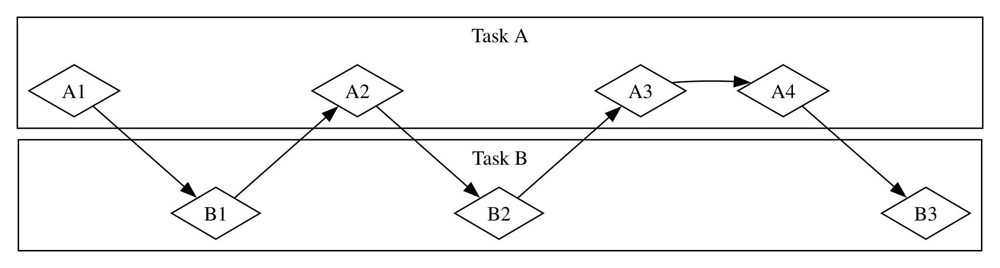
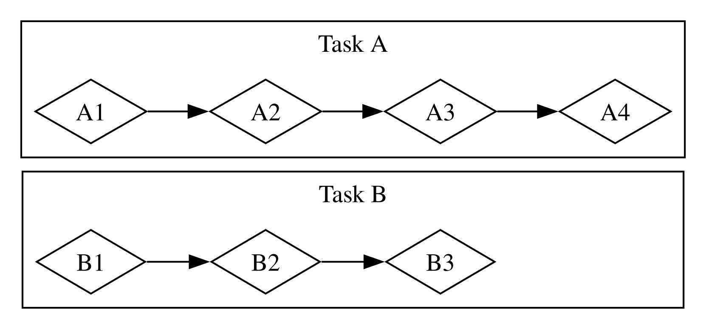
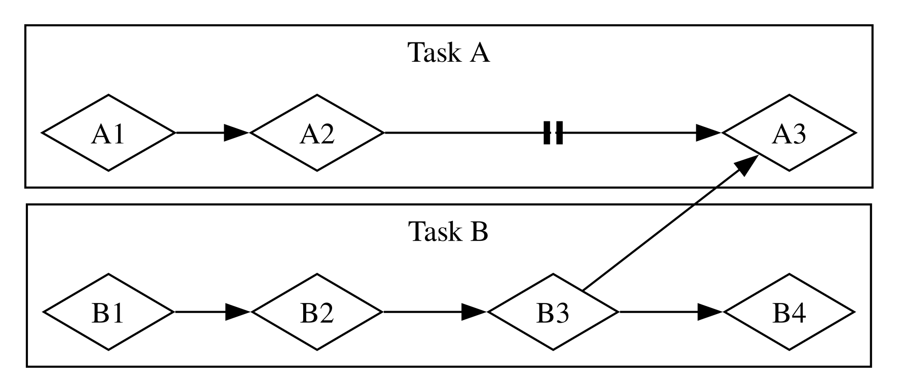

# Основы асинхронного программирования: async, await, future и потоки значений

Многие операции, которые мы поручаем компьютеру, выполняются не сразу. Было бы удобно заниматься чем-то ещё, пока мы ждём их завершения. Современные компьютеры предлагают два подхода к работе с несколькими операциями: параллелизм и конкурентность. Однако логика программ обычно записывается преимущественно линейно. Нам хотелось бы указывать, какие операции должна выполнить программа и в каких точках функция может приостановиться, уступив выполнение другой части программы, не задавая заранее точный порядок и способ выполнения каждого фрагмента. *Асинхронное программирование* — абстракция, позволяющая описывать код через возможные точки приостановки и будущие результаты, беря на себя подробности координации.

В главе 16 мы использовали потоки для параллельного и конкурентного выполнения. Эта глава развивает тему и знакомит с другим подходом: future, потоками значений и синтаксисом `async` и `await` в Rust, позволяющими выражать асинхронные операции. Мы также рассмотрим сторонние крейты, реализующие асинхронные среды выполнения — код, управляющий выполнением и координацией таких операций.

Рассмотрим пример. Вы экспортируете созданное вами видео семейного праздника. Это может занять от нескольких минут до нескольких часов. Экспорт задействует столько ресурсов CPU и GPU, сколько сможет. Если бы у компьютера было только одно ядро, а операционная система не приостанавливала экспорт до его завершения — то есть выполняла его *синхронно*, — всё это время вы не могли бы делать на компьютере ничего другого. Это было бы весьма неудобно. К счастью, операционная система умеет незаметно прерывать экспорт достаточно часто, чтобы вы одновременно могли выполнять другую работу.

Теперь предположим, что вы скачиваете чужое видео. Это тоже может занять время, но процессор занят гораздо меньше: ему приходится ждать поступления данных из сети. Начать читать данные можно по мере их поступления, однако до получения всех данных может пройти немало времени. Даже когда данные уже получены, загрузка большого видео целиком может занять одну-две секунды. На первый взгляд это немного, но для современного процессора, выполняющего миллиарды операций в секунду, это огромный промежуток. И здесь операционная система незаметно прерывает программу, позволяя процессору заниматься другой работой в ожидании завершения сетевой операции.

Экспорт видео — пример операции, *ограниченной производительностью процессора* (CPU-bound, или compute-bound). Её скорость ограничена возможностями обработки данных на CPU или GPU и долей этих возможностей, доступной операции. Скачивание видео — пример операции, *ограниченной вводом-выводом* (I/O-bound): она зависит от скорости *ввода и вывода* компьютера и не может выполняться быстрее, чем данные передаются по сети.

В обоих случаях незаметные прерывания операционной системы обеспечивают своего рода конкурентность. Однако она действует на уровне программ целиком: операционная система прерывает одну программу, чтобы дать поработать другим. Во многих случаях мы понимаем устройство своей программы гораздо подробнее, чем операционная система, и можем заметить возможности конкурентного выполнения, которые ей недоступны.

Например, создавая менеджер загрузок, мы хотим, чтобы начало скачивания не блокировало интерфейс и чтобы пользователь мог запустить несколько загрузок одновременно. Однако многие системные API для работы с сетью являются *блокирующими*: они останавливают продвижение программы, пока обрабатываемые данные не будут полностью готовы.

> Примечание: если задуматься, так работает *большинство* вызовов функций. Однако слово «блокирующий» обычно применяют к функциям, взаимодействующим с файлами, сетью и другими ресурсами компьютера, поскольку именно в этих случаях программе было бы полезно *неблокирующее* выполнение операции.

Чтобы не блокировать главный поток, можно создавать отдельный поток для загрузки каждого файла. Но со временем накладные расходы на системные ресурсы таких потоков станут проблемой. Лучше, если вызов вообще не будет блокирующим: мы определим набор задач для программы, а среда выполнения выберет подходящий порядок и способ их исполнения.

Именно это даёт абстракция *async* в Rust — сокращение от *asynchronous*, «асинхронный». В этой главе мы рассмотрим:

- Как использовать синтаксис `async` и `await` и выполнять асинхронные функции с помощью среды выполнения.
- Как решать с помощью асинхронной модели некоторые задачи, рассмотренные в главе 16.
- Как многопоточность и асинхронность дополняют друг друга и как их можно сочетать.

Прежде чем перейти к практике, ненадолго отвлечёмся и подробнее разберём различия между параллелизмом и конкурентностью.

## Параллелизм и конкурентность

До сих пор мы использовали эти понятия почти как взаимозаменяемые. Теперь необходимо различать их точнее: в дальнейшей работе это различие станет заметным.

Представьте, как команда может распределить работу над программным проектом. Можно поручить одному человеку несколько задач, выдать каждому по одной задаче или совместить оба подхода.

Когда один человек занимается несколькими задачами, не завершив ещё ни одну из них, это *конкурентность*. Представьте, что у вас на компьютере открыты два проекта. Когда один надоедает или работа над ним заходит в тупик, вы переключаетесь на другой. Вы один, поэтому не можете продвигаться в обеих задачах в один и тот же момент. Но вы можете заниматься несколькими задачами, поочерёдно работая над ними и переключаясь между ними (рисунок 17-1).

Рисунок 17-1: Конкурентная работа с переключениями между задачами A и B

Когда команда распределяет задачи так, что каждый участник самостоятельно занимается своей, это *параллелизм*. Все участники могут продвигаться в работе в один и тот же момент (рисунок 17-2).

Рисунок 17-2: Параллельная работа, при которой задачи A и B выполняются независимо

В обоих подходах может потребоваться координация задач. Возможно, сначала задача одного человека казалась полностью независимой, но затем выяснилось, что для её продолжения другой участник должен закончить свою работу. Часть действий могла выполняться параллельно, а часть оказалась *последовательной*: их можно выполнять только одно за другим, как на рисунке 17-3.

Рисунок 17-3: Частично параллельная работа: задачи A и B независимы до тех пор, пока A3 не потребуется результат B3

Аналогично может выясниться, что одна из ваших собственных задач зависит от другой. Тогда и ваша конкурентная работа становится последовательной.

Параллелизм и конкурентность могут пересекаться. Если коллега не может продолжить работу, пока вы не закончите одну из своих задач, вы, вероятно, сосредоточитесь на ней, чтобы разблокировать его работу. В этот момент вы с коллегой уже не работаете параллельно, а вы сами перестаёте конкурентно заниматься несколькими своими задачами.

Те же закономерности действуют в программном и аппаратном обеспечении. На компьютере с одним ядром процессор выполняет лишь одну операцию за раз, но конкурентность всё равно возможна. Благодаря потокам, процессам и асинхронности компьютер приостанавливает одну деятельность, переключается на другую и впоследствии возвращается к первой. Многоядерный компьютер способен также работать параллельно: одно ядро выполняет одну задачу, а другое — совершенно независимую, причём это происходит действительно одновременно.

Асинхронный код в Rust обычно выполняется конкурентно. В зависимости от аппаратного обеспечения, операционной системы и выбранной асинхронной среды выполнения — о них мы вскоре поговорим — за этой конкурентностью может стоять и параллелизм.

Теперь разберёмся, как устроено асинхронное программирование на Rust.
