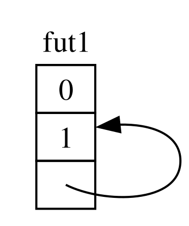
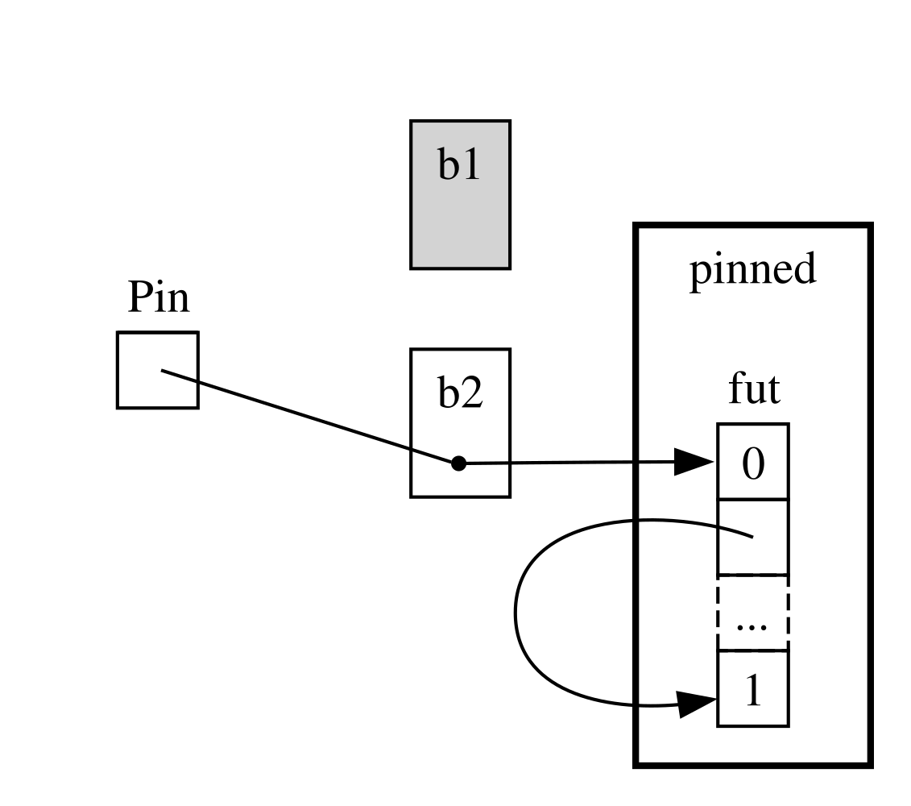
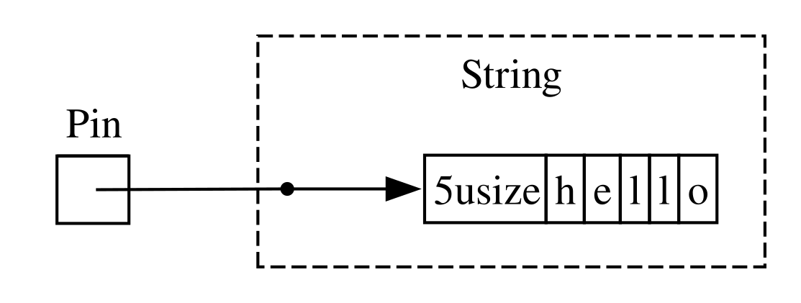
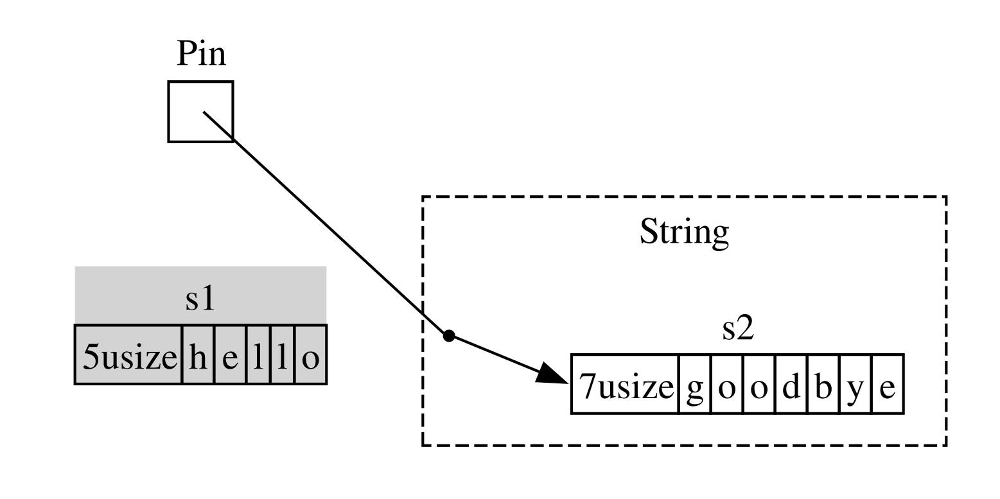

<span id="digging-into-the-traits-for-async"></span>

<a id="a-closer-look-at-the-traits-for-async"></a>

## Подробнее о типажах для асинхронного программирования

На протяжении этой главы мы по-разному использовали типажи `Future`, `Stream` и `StreamExt`. Однако до сих пор мы не углублялись в то, как они устроены и связаны друг с другом: для повседневной работы на Rust этих подробностей обычно не требуется. Но иногда возникают ситуации, когда нужно лучше понимать эти типажи, а также тип `Pin` и типаж `Unpin`. В этом разделе мы разберём ровно столько деталей, сколько нужно для подобных случаев; *по-настоящему* глубокое погружение оставим другой документации.

<span id="future"></span>

<a id="the-future-trait"></a>

### Типаж `Future`

Начнём с более внимательного рассмотрения типажа `Future`. Вот его определение в Rust:

``` rust
use std::pin::Pin;
use std::task::{Context, Poll};

pub trait Future {
    type Output;

    fn poll(self: Pin<&mut Self>, cx: &mut Context<'_>) -> Poll<Self::Output>;
}
```

В этом определении есть несколько новых типов и незнакомый синтаксис. Разберём его по частям.

Во-первых, ассоциированный тип `Output` указывает, во что разрешится future. Он аналогичен ассоциированному типу `Item` типажа `Iterator`. Во-вторых, у `Future` есть метод `poll`: его параметр `self` — особая ссылка в `Pin`; кроме того, метод принимает изменяемую ссылку на `Context` и возвращает `Poll<Self::Output>`. О `Pin` и `Context` мы вскоре поговорим подробнее. Пока сосредоточимся на возвращаемом типе `Poll`:

``` rust
pub enum Poll<T> {
    Ready(T),
    Pending,
}
```

Тип `Poll` похож на `Option`: у него есть вариант со значением, `Ready(T)`, и вариант без значения, `Pending`. Но смысл `Poll` совсем другой! Вариант `Pending` означает, что у future ещё осталась работа и вызывающему коду нужно проверить его позже. Вариант `Ready` означает, что `Future` завершил работу и значение `T` доступно.

> Примечание: непосредственно вызывать `poll` приходится редко. Но если это необходимо, помните: для большинства future после возврата `Ready` вызывать `poll` повторно не следует. Многие future при повторном опросе после готовности паникуют. Если future допускает повторный опрос, об этом явно говорится в его документации. Это похоже на поведение `Iterator::next`.

Когда вы пишете `await`, Rust превращает его в код, вызывающий `poll`. Вспомним листинг 17-4, где после получения результата мы печатали заголовок страницы по одному URL. Компилятор Rust преобразует этот код примерно, хотя и не в точности, следующим образом:

``` rust
match page_title(url).poll() {
    Ready(page_title) => match page_title {
        Some(title) => println!("The title for {url} was {title}"),
        None => println!("{url} had no title"),
    }
    Pending => {
        // But what goes here?
    }
}
```

Что делать, если future всё ещё возвращает `Pending`? Нужен способ пробовать снова и снова, пока результат наконец не будет готов. Иначе говоря, нужен цикл:

``` rust
let mut page_title_fut = page_title(url);
loop {
    match page_title_fut.poll() {
        Ready(value) => match page_title {
            Some(title) => println!("The title for {url} was {title}"),
            None => println!("{url} had no title"),
        }
        Pending => {
            // continue
        }
    }
}
```

Но если бы Rust генерировал именно такой код, каждый `await` блокировал бы выполнение — получилась бы полная противоположность нашей цели! Вместо этого Rust обеспечивает возможность передать управление из цикла тому, кто приостановит работу над этим future, займётся другими, а позже проверит его снова. Как мы уже видели, эту роль играет асинхронная среда выполнения; планирование и координация работы — одни из её основных задач.

В разделе [«Передача данных между двумя задачами с помощью сообщений»](ch17-02-concurrency-with-async.md#sending-data-between-two-tasks-using-message-passing) мы рассматривали ожидание `rx.recv`. Вызов `recv` возвращает future, а ожидание этого future приводит к его опросу. Мы отмечали, что среда выполнения приостанавливает future до готовности результата: `Some(message)` либо `None`, если канал закрыт. Теперь, лучше понимая типаж `Future` и особенно `Future::poll`, мы можем объяснить механизм. По возврату `Poll::Pending` среда выполнения узнаёт, что future ещё не готов. И наоборот, когда `poll` возвращает `Poll::Ready(Some(message))` или `Poll::Ready(None)`, среда понимает, что результат *готов*, и продолжает выполнение.

Подробности реализации этого механизма выходят за рамки книги. Главное — понять основы работы future: среда выполнения *опрашивает* каждый future, за который отвечает, и снова усыпляет его, если он ещё не готов.

<span id="pinning-and-the-pin-and-unpin-traits"></span> <span id="the-pin-and-unpin-traits"></span>

<a id="the-pin-type-and-the-unpin-trait"></a>

### Тип `Pin` и типаж `Unpin`

В листинге 17-13 мы ожидали три future с помощью макроса `trpl::join!`. Однако часто future хранятся в коллекции, например в векторе, и их количество становится известно только во время выполнения. Изменим листинг 17-13, как показано в листинге 17-23: поместим три future в вектор и вызовем функцию `trpl::join_all`. Пока этот код не скомпилируется.

Файл: `src/main.rs`

``` rust
        let tx_fut = async move {
            // --snip--
        };

        let futures: Vec<Box<dyn Future<Output = ()>>> =
            vec![Box::new(tx1_fut), Box::new(rx_fut), Box::new(tx_fut)];

        trpl::join_all(futures).await;
```

Листинг 17-23: Ожидание future, находящихся в коллекции

Мы поместили каждый future в `Box`, превратив его в *объект типажа*, как делали в разделе «Возврат ошибок из `run`» главы 12. Подробно объекты типажей рассматриваются в главе 18. Они позволяют обращаться с разными анонимными future как со значениями одного типа, поскольку все они реализуют типаж `Future`.

Это может удивить: ведь ни один из асинхронных блоков ничего не возвращает, а значит, каждый создаёт `Future<Output = ()>`. Но вспомните: `Future` — это типаж, а для каждого асинхронного блока компилятор создаёт отдельное перечисление, даже если типы результатов совпадают. Как нельзя поместить в один `Vec` две разные написанные вручную структуры, так нельзя смешивать и сгенерированные компилятором перечисления.

Затем мы передаём коллекцию future функции `trpl::join_all` и ожидаем результат. Однако код не компилируется. Вот существенная часть сообщений об ошибках:

``` text
error[E0277]: `dyn Future<Output = ()>` cannot be unpinned
  --> src/main.rs:48:33
   |
48 |         trpl::join_all(futures).await;
   |                                 ^^^^^ the trait `Unpin` is not implemented for `dyn Future<Output = ()>`
   |
   = note: consider using the `pin!` macro
           consider using `Box::pin` if you need to access the pinned value outside of the current scope
   = note: required for `Box<dyn Future<Output = ()>>` to implement `Future`
note: required by a bound in `futures_util::future::join_all::JoinAll`
  --> file:///home/.cargo/registry/src/index.crates.io-1949cf8c6b5b557f/futures-util-0.3.30/src/future/join_all.rs:29:8
   |
27 | pub struct JoinAll<F>
   |            ------- required by a bound in this struct
28 | where
29 |     F: Future,
   |        ^^^^^^ required by this bound in `JoinAll`
```

Примечание в сообщении об ошибке предлагает использовать макрос `pin!`, чтобы *закрепить* значения, то есть поместить их в тип `Pin`, гарантирующий, что они не будут перемещены в памяти. Согласно сообщению, закрепление необходимо, потому что `dyn Future<Output = ()>` должен реализовывать типаж `Unpin`, а сейчас этого не делает.

Функция `trpl::join_all` возвращает структуру `JoinAll`. Она обобщена по типу `F`, для которого задано ограничение: он должен реализовывать `Future`. Непосредственное ожидание future с помощью `await` неявно закрепляет его. Именно поэтому нам не приходится применять `pin!` всякий раз, когда мы хотим ожидать future.

Здесь же мы не ожидаем future непосредственно. Вместо этого, передавая коллекцию future функции `join_all`, мы создаём новый future — `JoinAll`. Сигнатура `join_all` требует, чтобы тип каждого элемента коллекции реализовывал `Future`, а `Box<T>` реализует `Future` лишь тогда, когда заключённый в нём `T` — это future, реализующий `Unpin`.

Сразу усвоить всё это непросто! Чтобы действительно разобраться, подробнее рассмотрим работу типажа `Future`, особенно закрепление. Ещё раз взглянем на его определение:

``` rust
use std::pin::Pin;
use std::task::{Context, Poll};

pub trait Future {
    type Output;

    // Required method
    fn poll(self: Pin<&mut Self>, cx: &mut Context<'_>) -> Poll<Self::Output>;
}
```

Параметр `cx` типа `Context` позволяет среде выполнения узнавать, когда проверять конкретный future, сохраняя ленивый характер вычислений. Детали снова выходят за рамки этой главы; обычно о них приходится думать лишь при написании собственной реализации `Future`. Мы сосредоточимся на типе `self`: впервые нам встретился метод с явной аннотацией этого параметра. Аннотация типа `self` похожа на аннотации других параметров функций, но есть два существенных отличия:

- Она сообщает Rust, каким должен быть тип `self`, чтобы можно было вызвать метод.
- Тип не может быть произвольным. Допускаются тип, для которого реализуется метод, ссылка или умный указатель на него, а также `Pin`, оборачивающий ссылку на этот тип.

Подробнее этот синтаксис рассматривается в [главе 18](ch18-00-oop.md). Пока достаточно знать: чтобы опросить future и проверить, возвращает ли он `Pending` или `Ready(Output)`, нам нужна изменяемая ссылка на его тип, обёрнутая в `Pin`.

`Pin` — обёртка для типов, подобных указателям: `&`, `&mut`, `Box` и `Rc`. Технически `Pin` работает с типами, реализующими `Deref` или `DerefMut`, но на практике это почти равнозначно работе только со ссылками и умными указателями. Сам `Pin` указателем не является и не имеет собственного поведения вроде подсчёта ссылок у `Rc` и `Arc`. Это исключительно средство, с помощью которого компилятор обеспечивает ограничения на использование указателей.

Если вспомнить, что `await` реализован через вызовы `poll`, смысл прежней ошибки начинает проясняться. Но в ней упоминался `Unpin`, а не `Pin`. Как именно они связаны и почему для вызова `poll` типаж `Future` требует, чтобы `self` был заключён в `Pin`?

Ранее в этой главе мы узнали, что последовательность точек ожидания внутри future компилируется в конечный автомат. Компилятор следит за соблюдением обычных правил безопасности Rust, в том числе правил заимствования и владения. Для этого Rust определяет, какие данные нужны между одной точкой ожидания и следующей либо концом асинхронного блока, и создаёт соответствующий вариант состояния автомата. Каждый вариант получает необходимый доступ к данным, используемым в этом участке исходного кода: владение ими либо изменяемую или неизменяемую ссылку.

Пока всё хорошо: если мы ошибёмся с владением или ссылками внутри асинхронного блока, проверка заимствований сообщит об этом. Сложности начинаются, когда мы хотим переместить соответствующий блоку future, например в `Vec`, чтобы передать его в `join_all`.

Перемещая future — будь то добавление в структуру данных, которую мы используем как итератор для `join_all`, или возврат из функции, — мы фактически перемещаем созданный Rust конечный автомат. В отличие от большинства типов Rust, future, созданные для асинхронных блоков, могут содержать в полях своих вариантов ссылки на самих себя. Упрощённо это показано на рисунке 17-4.



Рисунок 17-4: Тип данных со ссылкой на самого себя

В общем случае перемещать объект со ссылкой на самого себя небезопасно: ссылки всегда указывают на конкретный адрес в памяти, где находится их цель (рисунок 17-5). Если переместить саму структуру данных, её внутренние ссылки останутся направлены на старое место. Но это место в памяти уже недействительно. Во-первых, значение по старому адресу не будет обновляться при изменении структуры. Во-вторых, что ещё важнее, компьютер теперь вправе использовать эту память для других целей! Впоследствии вы можете прочитать совершенно посторонние данные.


Рисунок 17-5: Небезопасный результат перемещения типа со ссылкой на самого себя

Теоретически компилятор Rust мог бы обновлять все ссылки на объект при каждом его перемещении. Но это могло бы существенно снизить производительность, особенно при необходимости обновить целую сеть ссылок. Если же гарантировать, что структура данных *не перемещается в памяти*, обновлять ссылки не понадобится. Именно для этого служит проверка заимствований Rust: в безопасном коде она запрещает перемещать значение, на которое существует действующая ссылка.

`Pin` развивает этот подход и предоставляет нужную нам гарантию. Когда мы *закрепляем* значение, оборачивая указатель на него в `Pin`, оно больше не может перемещаться. Таким образом, при использовании `Pin<Box<SomeType>>` закрепляется значение `SomeType`, а *не* указатель `Box`. Это показано на рисунке 17-6.


Рисунок 17-6: Закрепление `Box`, указывающего на future со ссылкой на самого себя

Сам указатель `Box` по-прежнему можно свободно перемещать. Вспомним: нам нужно, чтобы в конечном счёте оставались на месте данные, на которые он указывает. Если указатель перемещается, *а его данные* остаются на прежнем месте, как на рисунке 17-7, проблемы не возникает. В качестве самостоятельного упражнения изучите документацию соответствующих типов и модуля `std::pin` и попробуйте выяснить, как выполнить такое перемещение, когда `Pin` оборачивает `Box`. Главное, что сам тип со ссылкой на себя не может переместиться, поскольку остаётся закреплённым.



Рисунок 17-7: Перемещение `Box`, указывающего на future со ссылкой на самого себя

Однако большинство типов можно совершенно безопасно перемещать, даже если доступ к ним осуществляется через `Pin`. О закреплении нужно думать лишь для значений с внутренними ссылками. Примитивные значения — например, числа и логические значения — безопасны: внутренних ссылок у них явно нет. Нет их и у большинства типов, с которыми вы обычно работаете в Rust. Например, `Vec` можно перемещать без опасений. Из сказанного пока следует, что с `Pin<Vec<String>>` пришлось бы работать исключительно через безопасный, но ограниченный API `Pin`, хотя `Vec<String>` всегда можно безопасно переместить, если на него нет других ссылок. Нужен способ сообщить компилятору, что в подобных случаях перемещение допустимо. Именно здесь появляется `Unpin`.

`Unpin` — маркерный типаж, подобный рассмотренным в главе 16 `Send` и `Sync`, поэтому собственной функциональности у него нет. Маркерные типажи лишь сообщают компилятору, что реализующий их тип безопасно использовать в определённом контексте. `Unpin` сообщает, что для данного типа *не требуется* поддерживать гарантии закрепления, ограничивающие безопасное перемещение значения.

Как и в случае `Send` и `Sync`, компилятор автоматически реализует `Unpin` для всех типов, для которых может доказать безопасность такой реализации. Особый случай, тоже похожий на `Send` и `Sync`, — отсутствие реализации `Unpin` у типа. Для этого используется запись `impl !Unpin for SomeType`, где `SomeType` — имя типа, который *должен* соблюдать эти гарантии для безопасности всякий раз, когда указатель на него используется внутри `Pin`.

Итак, о связи `Pin` и `Unpin` нужно помнить две вещи. Во-первых, `Unpin` — «обычный» случай, а `!Unpin` — особый. Во-вторых, наличие у типа реализации `Unpin` или `!Unpin` имеет значение *только* при использовании закреплённого указателя на этот тип, например `Pin<&mut SomeType>`.

Для конкретности рассмотрим `String`: у строки есть длина и составляющие её символы Unicode. Мы можем обернуть `String` в `Pin`, как показано на рисунке 17-8. Однако `String`, подобно большинству типов Rust, автоматически реализует `Unpin`.



Рисунок 17-8: Закрепление `String`; пунктир показывает, что `String` реализует `Unpin` и поэтому не закреплён

В результате мы можем выполнять действия, которые были бы запрещены, если бы `String` реализовывал `!Unpin`: например, заменить одну строку другой в том же месте памяти, как на рисунке 17-9. Это не нарушает контракт `Pin`, поскольку у `String` нет внутренних ссылок, делающих перемещение небезопасным. Именно поэтому он реализует `Unpin`, а не `!Unpin`.



Рисунок 17-9: Замена `String` совершенно другим значением `String` в памяти

Теперь мы можем разобраться в ошибках вызова `join_all` из листинга 17-23. Сначала мы попытались переместить future, созданные асинхронными блоками, в `Vec<Box<dyn Future<Output = ()>>>`. Но, как мы увидели, эти future могут содержать внутренние ссылки и потому не реализуют `Unpin` автоматически. После закрепления мы можем поместить получившиеся значения `Pin` в `Vec`, будучи уверенными, что лежащие в основе future данные *не переместятся*. В листинге 17-24 показано исправление: при определении каждого из трёх future вызывается `pin!`, а тип объекта типажа соответствующим образом изменяется.

``` rust
use std::pin::{Pin, pin};

// --snip--

        let tx1_fut = pin!(async move {
            // --snip--
        });

        let rx_fut = pin!(async {
            // --snip--
        });

        let tx_fut = pin!(async move {
            // --snip--
        });

        let futures: Vec<Pin<&mut dyn Future<Output = ()>>> =
            vec![tx1_fut, rx_fut, tx_fut];
```

Листинг 17-24: Закрепление future, позволяющее поместить их в вектор

Теперь пример компилируется и работает. Мы могли бы добавлять future в вектор или удалять их во время выполнения, а затем ожидать их все вместе.

`Pin` и `Unpin` особенно важны при создании низкоуровневых библиотек или самой среды выполнения; в повседневном коде Rust они встречаются реже. Но теперь, увидев их в сообщении об ошибке, вы будете лучше понимать, как исправить код!

> Примечание: сочетание `Pin` и `Unpin` позволяет безопасно реализовать в Rust целый класс сложных типов, которые иначе было бы трудно поддержать из-за ссылок на самих себя. Сегодня типы, которым нужен `Pin`, чаще всего встречаются в асинхронном Rust, но изредка появляются и в других контекстах.
>
> Устройство `Pin` и `Unpin` и правила, которые необходимо соблюдать при их использовании, подробно описаны в документации API модуля `std::pin`. Если хотите узнать больше, это отличная отправная точка.
>
> Ещё более подробное объяснение внутренних механизмов можно найти в главах [2](https://rust-lang.github.io/async-book/02_execution/01_chapter.html) и [4](https://rust-lang.github.io/async-book/04_pinning/01_chapter.html) книги [*Asynchronous Programming in Rust*](https://rust-lang.github.io/async-book/).

<a id="the-stream-trait"></a>

### Типаж `Stream`

Теперь, когда мы лучше понимаем `Future`, `Pin` и `Unpin`, перейдём к типажу `Stream`. Как вы узнали ранее в этой главе, потоки значений похожи на асинхронные итераторы. Однако в отличие от `Iterator` и `Future`, на момент написания книги определения `Stream` в стандартной библиотеке нет. Зато существует широко распространённое определение из крейта `futures`, которое используется во всей экосистеме.

Прежде чем объединить их в `Stream`, вспомним определения `Iterator` и `Future`. От `Iterator` мы берём понятие последовательности: его метод `next` возвращает `Option<Self::Item>`. От `Future` — понятие готовности, наступающей со временем: его метод `poll` возвращает `Poll<Self::Output>`. Чтобы представить последовательность элементов, которые становятся готовы со временем, определим типаж `Stream`, объединяющий эти возможности:

``` rust
use std::pin::Pin;
use std::task::{Context, Poll};

trait Stream {
    type Item;

    fn poll_next(
        self: Pin<&mut Self>,
        cx: &mut Context<'_>
    ) -> Poll<Option<Self::Item>>;
}
```

Типаж `Stream` определяет ассоциированный тип `Item` — тип элементов, которые выдаёт поток. Это похоже на `Iterator`, у которого элементов может быть от нуля до сколь угодно большого числа, и отличается от `Future`, у которого всегда один результат `Output`, даже если это единичный тип `()`.

Кроме того, `Stream` определяет метод получения этих элементов. Мы называем его `poll_next`, подчёркивая, что он опрашивает готовность подобно `Future::poll` и выдаёт последовательность элементов подобно `Iterator::next`. Его возвращаемый тип объединяет `Poll` и `Option`. Снаружи находится `Poll`: как и у future, нужно проверять готовность. Внутри находится `Option`: как и итератор, поток должен сообщать, остались ли ещё сообщения.

Вероятно, очень похожее определение со временем войдёт в стандартную библиотеку Rust. Пока оно входит в набор средств большинства сред выполнения, поэтому на него можно опираться, а дальнейшие объяснения в целом применимы и к ним!

Однако в примерах раздела [«Потоки: последовательности future»](ch17-04-streams.md) мы использовали не `poll_next` и `Stream`, а `next` и `StreamExt`. Конечно, мы *могли бы* работать непосредственно с API `poll_next`, вручную написав конечный автомат для `Stream`, как могли бы работать с future напрямую через `poll`. Но пользоваться `await` намного удобнее, и типаж `StreamExt` предоставляет метод `next` именно для этого:

``` rust
trait StreamExt: Stream {
    async fn next(&mut self) -> Option<Self::Item>
    where
        Self: Unpin;

    // other methods...
}
```

> Примечание: фактическое определение, использованное ранее в главе, немного отличается: оно поддерживает версии Rust, в которых асинхронные функции в типажах ещё не были доступны. Поэтому оно выглядит так:
>
> ``` rust
> fn next(&mut self) -> Next<'_, Self> where Self: Unpin;
> ```
>
> Тип `Next` — структура, реализующая `Future`. Запись `Next<'_, Self>` позволяет указать время жизни ссылки на `self`, благодаря чему с этим методом работает `await`.

Типаж `StreamExt` содержит и все остальные полезные методы для работы с потоками. Он автоматически реализуется для каждого типа, реализующего `Stream`. Эти типажи определены отдельно, чтобы сообщество могло развивать удобный API, не затрагивая базовый типаж.

В варианте `StreamExt`, используемом крейтом `trpl`, не только объявлен метод `next`, но и предоставлена его реализация по умолчанию, которая правильно вызывает `Stream::poll_next`. Поэтому, даже если вам нужно создать собственный тип потока данных, достаточно реализовать *только* `Stream`; после этого любой пользователь вашего типа автоматически сможет применять `StreamExt` и его методы.

На этом мы закончим разбор низкоуровневого устройства этих типажей. В завершение посмотрим, как связаны между собой future, включая потоки значений, задачи и потоки выполнения!
