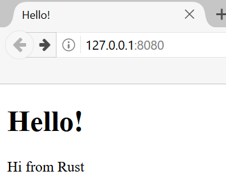

# Финальный проект: создание многопоточного веб-сервера

Это был долгий путь, но мы дошли до финала книги. В этой главе мы сделаем ещё один проект, чтобы закрепить несколько тем из последних глав и резюмировать то, что прошли в самом начале.

В качестве нашего финального проекта мы напишем веб-сервер, который выводит надпись “hello” в веб-браузере, как на рисунке 21-1.

Для создания веб-сервера нам понадобится:

1.  Узнать немного о протоколах TCP и HTTP.
2.  Сделать прослушивание TCP соединения у сокета.
3.  Создать функциональность для парсинга небольшого количества HTTP-запросов.
4.  Научить сервер отдавать корректный HTTP-ответ.
5.  Улучшить пропускную способность нашего сервера с помощью пула потоков.

Рисунок 21-1: Наш последний совместный проект

Перед началом отметим два обстоятельства. Во-первых, наш способ — не лучший вариант создания веб-сервера на Rust. На [crates.io](https://crates.io/) сообщество опубликовало готовые к промышленному использованию крейты с более полными реализациями серверов и пулов потоков. Но цель главы — обучение, а не самый лёгкий путь. Rust — язык системного программирования, поэтому мы можем выбирать уровень абстракции и спускаться ниже, чем это возможно или удобно в других языках.

Во-вторых, здесь мы не будем использовать async и await. Создание пула потоков — само по себе достаточно сложная задача, чтобы не добавлять к ней разработку асинхронной среды выполнения! Однако мы будем отмечать, как async и await могли бы применяться к тем же задачам. Ведь, как говорилось в главе 17, многие асинхронные среды выполнения управляют работой с помощью пулов потоков.

Поэтому базовый HTTP-сервер и пул потоков мы напишем вручную: так вы узнаете общие идеи и приёмы, лежащие в основе крейтов, которыми, возможно, будете пользоваться в будущем.
